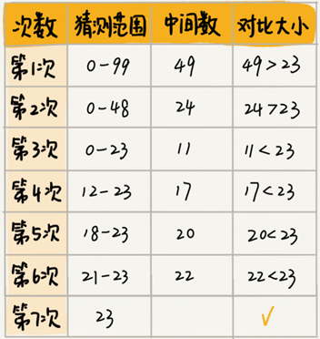
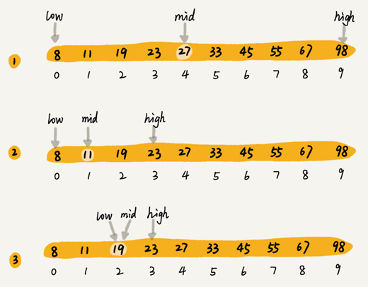
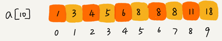

# 二分查找（上）：如何用最省内存的方式实现快速查找功能？

今天我们讲一种针对有序数据集合的查找算法：二分查找（Binary Search）算法，也叫折半查找算法。二分查找的思想非常简单，很多非计算机专业的同学很容易就能理解，但是看似越简单的东西往往越难掌握好，想要灵活应用就更加困难。

老规矩，我们还是来看一道思考题。

假设我们有 1000 万个整数数据，每个数据占 8 个字节，**如何设计数据结构和算法，快速判断某个整数是否出现在这 1000 万数据中？** 我们希望这个功能不要占用太多的内存空间，最多不要超过 100MB，你会怎么做呢？带着这个问题，让我们进入今天的内容吧！

## 无处不在的二分思想

二分查找是一种非常简单易懂的快速查找算法，生活中到处可见。比如说，我们现在来做一个猜字游戏。我随机写一个 0 到 99 之间的数字，然后你来猜我写的是什么。猜的过程中，你每猜一次，我就会告诉你猜的大了还是小了，直到猜中为止。你来想想，如何快速猜中我写的数字呢？

假设我写的数字是 23，你可以按照下面的步骤来试一试。（如果猜测范围的数字有偶数个，中间数有两个，就选择较小的那个。）



7 次就猜出来了，是不是很快？这个例子用的就是二分思想，按照这个思想，即便我让你猜的是 0 到 999 的数字，最多也只要 10 次就能猜中。不信的话，你可以试一试。

这是一个生活中的例子，我们现在回到实际的开发场景中。假设有 1000 条订单数据，已经按照订单金额从小到大排序，每个订单金额都不同，并且最小单位是元。我们现在想知道是否存在金额等于 19 元的订单。如果存在，则返回订单数据，如果不存在则返回 null。

最简单的办法当然是从第一个订单开始，一个一个遍历这 1000 个订单，直到找到金额等于 19 元的订单为止。但这样查找会比较慢，最坏情况下，可能要遍历完这 1000 条记录才能找到。那用二分查找能不能更快速地解决呢？

为了方便讲解，我们假设只有 10 个订单，订单金额分别是：8，11，19，23，27，33，45，55，67，98。

还是利用二分思想，每次都与区间的中间数据比对大小，缩小查找区间的范围。为了更加直观，我画了一张查找过程的图。其中，low 和 high 表示待查找区间的下标，mid 表示待查找区间的中间元素下标。



看懂这两个例子，你现在对二分的思想应该掌握得妥妥的了。我这里稍微总结升华一下，**二分查找针对的是一个有序的数据集合，查找思想有点类似分治思想。每次都通过跟区间的中间元素对比，将待查找的区间缩小为之前的一半，直到找到要查找的元素，或者区间被缩小为 0**。

## O(logn) 惊人的查找速度

二分查找是一种非常高效的查找算法，高效到什么程度呢？我们来分析一下它的时间复杂度。

我们假设数据大小是 n，每次查找后数据都会缩小为原来的一半，也就是会除以 2。最坏情况下，直到查找区间被缩小为空，才停止。

被查找区间的大小变化：
$$
n, \frac{n}{2}, \frac{n}{4}, \frac{n}{8}, \cdots, \frac{n}{2^{k}} \cdots
$$
可以看出来，这是一个等比数列。其中 n/2k=1 时，k 的值就是总共缩小的次数。而每一次缩小操作只涉及两个数据的大小比较，所以，经过了 k 次区间缩小操作，时间复杂度就是 O(k)。通过 n/2k=1，我们可以求得 k=log2n，所以时间复杂度就是 O(logn)。

二分查找是我们目前为止遇到的第一个时间复杂度为 O(logn) 的算法。后面章节我们还会讲堆、二叉树的操作等等，它们的时间复杂度也是 O(logn)。我这里就再深入地讲讲 O(logn) 这种**对数时间复杂度**。这是一种极其高效的时间复杂度，有的时候甚至比时间复杂度是常量级 O(1) 的算法还要高效。为什么这么说呢？

因为 logn 是一个非常“恐怖”的数量级，即便 n 非常非常大，对应的 logn 也很小。比如 n 等于 2 的 32 次方，这个数很大了吧？大约是 42 亿。也就是说，如果我们在 42 亿个数据中用二分查找一个数据，最多需要比较 32 次。

我们前面讲过，用大 O 标记法表示时间复杂度的时候，会省略掉常数、系数和低阶。对于常量级时间复杂度的算法来说，O(1) 有可能表示的是一个非常大的常量值，比如 O(1000)、O(10000)。所以，常量级时间复杂度的算法有时候可能还没有 O(logn) 的算法执行效率高。

反过来，对数对应的就是指数。有一个非常著名的“阿基米德与国王下棋的故事”，你可以自行搜索一下，感受一下指数的“恐怖”。这也是为什么我们说，指数时间复杂度的算法在大规模数据面前是无效的。

## 二分查找的递归与非递归实现

实际上，简单的二分查找并不难写，注意我这里的“简单”二字。下一节，我们会讲到二分查找的变体问题，那才是真正烧脑的。今天，我们来看如何来写最简单的二分查找。

**最简单的情况**就是**有序数组中不存在重复元素**，我们在其中用二分查找值等于给定值的数据。我用 Java 代码实现了一个最简单的二分查找算法。

```java
public int bsearch(int[] a, int n, int value) {
  int low = 0;
  int high = n - 1;
 
  while (low <= high) {
    int mid = (low + high) / 2;
    if (a[mid] == value) {
      return mid;
    } else if (a[mid] < value) {
      low = mid + 1;
    } else {
      high = mid - 1;
    }
  }
 
  return -1;
}
```

这个代码我稍微解释一下，low、high、mid 都是指数组下标，其中 low 和 high 表示当前查找的区间范围，初始 low=0， high=n-1。mid 表示 [low, high] 的中间位置。我们通过对比 a[mid] 与 value 的大小，来更新接下来要查找的区间范围，直到找到或者区间缩小为 0，就退出。如果你有一些编程基础，看懂这些应该不成问题。现在，我就着重强调一下**容易出错的 3 个地方**。

### 1. 循环退出条件

注意是 low<=high，而不是 low<high。

### 2.mid 的取值

实际上，mid=(low+high)/2 这种写法是有问题的。因为如果 low 和 high 比较大的话，两者之和就有可能会溢出。改进的方法是将 mid 的计算方式写成 low+(high-low)/2。更进一步，如果要将性能优化到极致的话，我们可以将这里的除以 2 操作转化成位运算 low+((high-low)>>1)。因为相比除法运算来说，计算机处理位运算要快得多。

### 3.low 和 high 的更新

low=mid+1，high=mid-1。注意这里的 +1 和 -1，如果直接写成 low=mid 或者 high=mid，就可能会发生死循环。比如，当 high=3，low=3 时，如果 a[3] 不等于 value，就会导致一直循环不退出。

如果你留意我刚讲的这三点，我想一个简单的二分查找你已经可以实现了。**实际上，二分查找除了用循环来实现，还可以用递归来实现**，过程也非常简单。

我用 Java 语言实现了一下这个过程，正好你可以借此机会回顾一下写递归代码的技巧。

```java
// 二分查找的递归实现
public int bsearch(int[] a, int n, int val) {
  return bsearchInternally(a, 0, n - 1, val);
}
 
private int bsearchInternally(int[] a, int low, int high, int value) {
  if (low > high) return -1;
 
  int mid =  low + ((high - low) >> 1);
  if (a[mid] == value) {
    return mid;
  } else if (a[mid] < value) {
    return bsearchInternally(a, mid+1, high, value);
  } else {
    return bsearchInternally(a, low, mid-1, value);
  }
}
```

## 二分查找应用场景的局限性

前面我们分析过，二分查找的时间复杂度是 O(logn)，查找数据的效率非常高。不过，并不是什么情况下都可以用二分查找，它的应用场景是有很大局限性的。那什么情况下适合用二分查找，什么情况下不适合呢？

**首先，二分查找依赖的是顺序表结构，简单点说就是数组。**

那二分查找能否依赖其他数据结构呢？比如链表。答案是不可以的，主要原因是二分查找算法需要按照下标随机访问元素。我们在数组和链表那两节讲过，数组按照下标随机访问数据的时间复杂度是 O(1)，而链表随机访问的时间复杂度是 O(n)。所以，如果数据使用链表存储，二分查找的时间复杂就会变得很高。

二分查找只能用在数据是通过顺序表来存储的数据结构上。如果你的数据是通过其他数据结构存储的，则无法应用二分查找。

**其次，二分查找针对的是有序数据。**

二分查找对这一点的要求比较苛刻，数据必须是有序的。如果数据没有序，我们需要先排序。前面章节里我们讲到，排序的时间复杂度最低是 O(nlogn)。所以，如果我们针对的是一组静态的数据，没有频繁地插入、删除，我们可以进行一次排序，多次二分查找。这样排序的成本可被均摊，二分查找的边际成本就会比较低。

但是，如果我们的数据集合有频繁的插入和删除操作，要想用二分查找，要么每次插入、删除操作之后保证数据仍然有序，要么在每次二分查找之前都先进行排序。针对这种动态数据集合，无论哪种方法，维护有序的成本都是很高的。

所以，二分查找只能用在插入、删除操作不频繁，一次排序多次查找的场景中。针对动态变化的数据集合，二分查找将不再适用。那针对动态数据集合，如何在其中快速查找某个数据呢？别急，等到二叉树那一节我会详细讲。

**再次，数据量太小不适合二分查找。**

如果要处理的数据量很小，完全没有必要用二分查找，顺序遍历就足够了。比如我们在一个大小为 10 的数组中查找一个元素，不管用二分查找还是顺序遍历，查找速度都差不多。只有数据量比较大的时候，二分查找的优势才会比较明显。

不过，这里有一个例外。如果数据之间的比较操作非常耗时，不管数据量大小，我都推荐使用二分查找。比如，数组中存储的都是长度超过 300 的字符串，如此长的两个字符串之间比对大小，就会非常耗时。我们需要尽可能地减少比较次数，而比较次数的减少会大大提高性能，这个时候二分查找就比顺序遍历更有优势。

**最后，数据量太大也不适合二分查找。**

二分查找的底层需要依赖数组这种数据结构，而数组为了支持随机访问的特性，要求内存空间连续，对内存的要求比较苛刻。比如，我们有 1GB 大小的数据，如果希望用数组来存储，那就需要 1GB 的连续内存空间。

注意这里的“连续”二字，也就是说，即便有 2GB 的内存空间剩余，但是如果这剩余的 2GB 内存空间都是零散的，没有连续的 1GB 大小的内存空间，那照样无法申请一个 1GB 大小的数组。而我们的二分查找是作用在数组这种数据结构之上的，所以太大的数据用数组存储就比较吃力了，也就不能用二分查找了。

## 解答开篇

二分查找的理论知识你应该已经掌握了。我们来看下开篇的思考题：如何在 1000 万个整数中快速查找某个整数？

这个问题并不难。我们的内存限制是 100MB，每个数据大小是 8 字节，最简单的办法就是将数据存储在数组中，内存占用差不多是 80MB，符合内存的限制。借助今天讲的内容，我们可以先对这 1000 万数据从小到大排序，然后再利用二分查找算法，就可以快速地查找想要的数据了。

看起来这个问题并不难，很轻松就能解决。实际上，它暗藏了“玄机”。如果你对数据结构和算法有一定了解，知道散列表、二叉树这些支持快速查找的动态数据结构。你可能会觉得，用散列表和二叉树也可以解决这个问题。实际上是不行的。

虽然大部分情况下，用二分查找可以解决的问题，用散列表、二叉树都可以解决。但是，我们后面会讲，不管是散列表还是二叉树，都会需要比较多的额外的内存空间。如果用散列表或者二叉树来存储这 1000 万的数据，用 100MB 的内存肯定是存不下的。而二分查找底层依赖的是数组，除了数据本身之外，不需要额外存储其他信息，是最省内存空间的存储方式，所以刚好能在限定的内存大小下解决这个问题。

## 内容小结

今天我们学习了一种针对有序数据的高效查找算法，二分查找，它的时间复杂度是 O(logn)。

二分查找的核心思想理解起来非常简单，有点类似分治思想。即每次都通过跟区间中的中间元素对比，将待查找的区间缩小为一半，直到找到要查找的元素，或者区间被缩小为 0。但是二分查找的代码实现比较容易写错。你需要着重掌握它的三个容易出错的地方：循环退出条件、mid 的取值，low 和 high 的更新。

二分查找虽然性能比较优秀，但应用场景也比较有限。底层必须依赖数组，并且还要求数据是有序的。对于较小规模的数据查找，我们直接使用顺序遍历就可以了，二分查找的优势并不明显。二分查找更适合处理静态数据，也就是没有频繁的数据插入、删除操作。

## 课后思考

1. 如何编程实现“求一个数的平方根”？要求精确到小数点后 6 位。
2. 我刚才说了，如果数据使用链表存储，二分查找的时间复杂就会变得很高，那查找的时间复杂度究竟是多少呢？如果你自己推导一下，你就会深刻地认识到，为何我们会选择用数组而不是链表来实现二分查找了。

# 二分查找（下）：如何快速定位IP对应的省份地址？

通过 IP 地址来查找 IP 归属地的功能并不复杂，它是通过维护一个很大的 IP 地址库来实现的。地址库中包括 IP 地址范围和归属地的对应关系。

当我们想要查询 202.102.133.13 这个 IP 地址的归属地时，我们就在地址库中搜索，发现这个 IP 地址落在 [202.102.133.0, 202.102.133.255] 这个地址范围内，那我们就可以将这个 IP 地址范围对应的归属地“山东东营市”显示给用户了。

```
[202.102.133.0, 202.102.133.255]  山东东营市 
[202.102.135.0, 202.102.136.255]  山东烟台 
[202.102.156.34, 202.102.157.255] 山东青岛 
[202.102.48.0, 202.102.48.255] 江苏宿迁 
[202.102.49.15, 202.102.51.251] 江苏泰州 
[202.102.56.0, 202.102.56.255] 江苏连云港
```

现在我的问题是，在庞大的地址库中逐一比对 IP 地址所在的区间，是非常耗时的。**假设我们有 12 万条这样的 IP 区间与归属地的对应关系，如何快速定位出一个 IP 地址的归属地呢？**

是不是觉得比较难？不要紧，等学完今天的内容，你就会发现这个问题其实很简单。

上一节我讲了二分查找的原理，并且介绍了最简单的一种二分查找的代码实现。今天我们来讲几种二分查找的变形问题。

不知道你有没有听过这样一个说法：“十个二分九个错”。二分查找虽然原理极其简单，但是想要写出没有 Bug 的二分查找并不容易。

唐纳德·克努特（Donald E.Knuth）在《计算机程序设计艺术》的第 3 卷《排序和查找》中说到：“尽管第一个二分查找算法于 1946 年出现，然而第一个完全正确的二分查找算法实现直到 1962 年才出现。”

你可能会说，我们上一节学的二分查找的代码实现并不难写啊。那是因为上一节讲的只是二分查找中最简单的一种情况，在不存在重复元素的有序数组中，查找值等于给定值的元素。最简单的二分查找写起来确实不难，但是，二分查找的变形问题就没那么好写了。

二分查找的变形问题很多，我只选择几个典型的来讲解，其他的你可以借助我今天讲的思路自己来分析。


需要特别说明一点，为了简化讲解，今天的内容，我都以数据是从小到大排列为前提，如果你要处理的数据是从大到小排列的，解决思路也是一样的。同时，我希望你最好先自己动手试着写一下这 4 个变形问题，然后再看我的讲述，这样你就会对我说的“二分查找比较难写”有更加深的体会了。

## 变体一：查找第一个值等于给定值的元素

上一节中的二分查找是最简单的一种，即有序数据集合中不存在重复的数据，我们在其中查找值等于某个给定值的数据。如果我们将这个问题稍微修改下，有序数据集合中存在重复的数据，我们希望找到第一个值等于给定值的数据，这样之前的二分查找代码还能继续工作吗？

比如下面这样一个有序数组，其中，a[5]，a[6]，a[7] 的值都等于 8，是重复的数据。我们希望查找第一个等于 8 的数据，也就是下标是 5 的元素。



如果我们用上一节课讲的二分查找的代码实现，首先拿 8 与区间的中间值 a[4] 比较，8 比 6 大，于是在下标 5 到 9 之间继续查找。下标 5 和 9 的中间位置是下标 7，a[7] 正好等于 8，所以代码就返回了。

尽管 a[7] 也等于 8，但它并不是我们想要找的第一个等于 8 的元素，因为第一个值等于 8 的元素是数组下标为 5 的元素。我们上一节讲的二分查找代码就无法处理这种情况了。所以，针对这个变形问题，我们可以稍微改造一下上一节的代码。

100 个人写二分查找就会有 100 种写法。网上有很多关于变形二分查找的实现方法，有很多写得非常简洁，比如下面这个写法。但是，尽管简洁，理解起来却非常烧脑，也很容易写错。

```java
public int bsearch(int[] a, int n, int value) {
  int low = 0;
  int high = n - 1;
  while (low <= high) {
    int mid = low + ((high - low) >> 1);
    if (a[mid] >= value) {
      high = mid - 1;
    } else {
      low = mid + 1;
    }
  }
 
  if (low < n && a[low]==value) return low;
  else return -1;
}
```

看完这个实现之后，你是不是觉得很不好理解？如果你只是死记硬背这个写法，我敢保证，过不了几天，你就会全都忘光，再让你写，90% 的可能会写错。所以，我换了一种实现方法，你看看是不是更容易理解呢？

```java
public int bsearch(int[] a, int n, int value) {
  int low = 0;
  int high = n - 1;
  while (low <= high) {
    int mid =  low + ((high - low) >> 1);
    if (a[mid] > value) {
      high = mid - 1;
    } else if (a[mid] < value) {
      low = mid + 1;
    } else {
      if ((mid == 0) || (a[mid - 1] != value)) return mid;
      else high = mid - 1;
    }
  }
  return -1;
}
```

我来稍微解释一下这段代码。a[mid] 跟要查找的 value 的大小关系有三种情况：大于、小于、等于。对于 a[mid]>value 的情况，我们需要更新 high= mid-1；对于 a[mid]<value 的情况，我们需要更新 low=mid+1。这两点都很好理解。那当 a[mid]=value 的时候应该如何处理呢？

如果我们查找的是任意一个值等于给定值的元素，当 a[mid] 等于要查找的值时，a[mid] 就是我们要找的元素。但是，如果我们求解的是第一个值等于给定值的元素，当 a[mid] 等于要查找的值时，我们就需要确认一下这个 a[mid] 是不是第一个值等于给定值的元素。

我们重点看第 11 行代码。如果 mid 等于 0，那这个元素已经是数组的第一个元素，那它肯定是我们要找的；如果 mid 不等于 0，但 a[mid] 的前一个元素 a[mid-1] 不等于 value，那也说明 a[mid] 就是我们要找的第一个值等于给定值的元素。

如果经过检查之后发现 a[mid] 前面的一个元素 a[mid-1] 也等于 value，那说明此时的 a[mid] 肯定不是我们要查找的第一个值等于给定值的元素。那我们就更新 high=mid-1，因为要找的元素肯定出现在 [low, mid-1] 之间。

对比上面的两段代码，是不是下面那种更好理解？实际上，**很多人都觉得变形的二分查找很难写，主要原因是太追求第一种那样完美、简洁的写法**。而对于我们做工程开发的人来说，代码易读懂、没 Bug，其实更重要，所以我觉得第二种写法更好。

## 变体二：查找最后一个值等于给定值的元素

前面的问题是查找第一个值等于给定值的元素，我现在把问题稍微改一下，查找最后一个值等于给定值的元素，又该如何做呢？

如果你掌握了前面的写法，那这个问题你应该很轻松就能解决。你可以先试着实现一下，然后跟我写的对比一下。

```java
public int bsearch(int[] a, int n, int value) {
  int low = 0;
  int high = n - 1;
  while (low <= high) {
    int mid =  low + ((high - low) >> 1);
    if (a[mid] > value) {
      high = mid - 1;
    } else if (a[mid] < value) {
      low = mid + 1;
    } else {
      if ((mid == n - 1) || (a[mid + 1] != value)) return mid;
      else low = mid + 1;
    }
  }
  return -1;
}
```

我们还是重点看第 11 行代码。如果 a[mid] 这个元素已经是数组中的最后一个元素了，那它肯定是我们要找的；如果 a[mid] 的后一个元素 a[mid+1] 不等于 value，那也说明 a[mid] 就是我们要找的最后一个值等于给定值的元素。

如果我们经过检查之后，发现 a[mid] 后面的一个元素 a[mid+1] 也等于 value，那说明当前的这个 a[mid] 并不是最后一个值等于给定值的元素。我们就更新 low=mid+1，因为要找的元素肯定出现在 [mid+1, high] 之间。

## 变体三：查找第一个大于等于给定值的元素

现在我们再来看另外一类变形问题。在有序数组中，查找第一个大于等于给定值的元素。比如，数组中存储的这样一个序列：3，4，6，7，10。如果查找第一个大于等于 5 的元素，那就是 6。

实际上，实现的思路跟前面的那两种变形问题的实现思路类似，代码写起来甚至更简洁。

```java
public int bsearch(int[] a, int n, int value) {
  int low = 0;
  int high = n - 1;
  while (low <= high) {
    int mid =  low + ((high - low) >> 1);
    if (a[mid] >= value) {
      if ((mid == 0) || (a[mid - 1] < value)) return mid;
      else high = mid - 1;
    } else {
      low = mid + 1;
    }
  }
  return -1;
}
```

如果 a[mid] 小于要查找的值 value，那要查找的值肯定在 [mid+1, high] 之间，所以，我们更新 low=mid+1。

对于 a[mid] 大于等于给定值 value 的情况，我们要先看下这个 a[mid] 是不是我们要找的第一个值大于等于给定值的元素。如果 a[mid] 前面已经没有元素，或者前面一个元素小于要查找的值 value，那 a[mid] 就是我们要找的元素。这段逻辑对应的代码是第 7 行。

如果 a[mid-1] 也大于等于要查找的值 value，那说明要查找的元素在 [low, mid-1] 之间，所以，我们将 high 更新为 mid-1。

## 变体四：查找最后一个小于等于给定值的元素

现在，我们来看最后一种二分查找的变形问题，查找最后一个小于等于给定值的元素。比如，数组中存储了这样一组数据：3，5，6，8，9，10。最后一个小于等于 7 的元素就是 6。是不是有点类似上面那一种？实际上，实现思路也是一样的。

有了前面的基础，你完全可以自己写出来了，所以我就不详细分析了。我把代码贴出来，你可以写完之后对比一下。

```java
public int bsearch7(int[] a, int n, int value) {
  int low = 0;
  int high = n - 1;
  while (low <= high) {
    int mid =  low + ((high - low) >> 1);
    if (a[mid] > value) {
      high = mid - 1;
    } else {
      if ((mid == n - 1) || (a[mid + 1] > value)) return mid;
      else low = mid + 1;
    }
  }
  return -1;
}
```

## 解答开篇

好了，现在我们回头来看开篇的问题：如何快速定位出一个 IP 地址的归属地？

现在这个问题应该很简单了。如果 IP 区间与归属地的对应关系不经常更新，我们可以先预处理这 12 万条数据，让其按照起始 IP 从小到大排序。如何来排序呢？我们知道，IP 地址可以转化为 32 位的整型数。所以，我们可以将起始地址，按照对应的整型值的大小关系，从小到大进行排序。

然后，这个问题就可以转化为我刚讲的第四种变形问题“在有序数组中，查找最后一个小于等于某个给定值的元素”了。

当我们要查询某个 IP 归属地时，我们可以先通过二分查找，找到最后一个起始 IP 小于等于这个 IP 的 IP 区间，然后，检查这个 IP 是否在这个 IP 区间内，如果在，我们就取出对应的归属地显示；如果不在，就返回未查找到。

## 内容小结

上一节我说过，凡是用二分查找能解决的，绝大部分我们更倾向于用散列表或者二叉查找树。即便是二分查找在内存使用上更节省，但是毕竟内存如此紧缺的情况并不多。那二分查找真的没什么用处了吗？

实际上，上一节讲的求“值等于给定值”的二分查找确实不怎么会被用到，二分查找更适合用在“近似”查找问题，在这类问题上，二分查找的优势更加明显。比如今天讲的这几种变体问题，用其他数据结构，比如散列表、二叉树，就比较难实现了。

变体的二分查找算法写起来非常烧脑，很容易因为细节处理不好而产生 Bug，这些容易出错的细节有：**终止条件、区间上下界更新方法、返回值选择**。所以今天的内容你最好能用自己实现一遍，对锻炼编码能力、逻辑思维、写出 Bug free 代码，会很有帮助。

## 课后思考

我们今天讲的都是非常规的二分查找问题，今天的思考题也是一个非常规的二分查找问题。如果有序数组是一个循环有序数组，比如 4，5，6，1，2，3。针对这种情况，如何实现一个求“值等于给定值”的二分查找算法呢？

