# 堆和堆排序：为什么说堆排序没有快速排序快？

我们今天讲另外一种特殊的树，“堆”（$Heap$）。堆这种数据结构的应用场景非常多，最经典的莫过于堆排序了。堆排序是一种原地的、时间复杂度为 $O(nlogn)$ 的排序算法。

前面我们学过快速排序，平均情况下，它的时间复杂度为 $O(nlogn)$。尽管这两种排序算法的时间复杂度都是 $O(nlogn)$，甚至堆排序比快速排序的时间复杂度还要稳定，但是，**在实际的软件开发中，快速排序的性能要比堆排序好，这是为什么呢？**

现在，你可能还无法回答，甚至对问题本身还有点疑惑。没关系，带着这个问题，我们来学习今天的内容。等你学完之后，或许就能回答出来了。

## 如何理解“堆”？

前面我们提到，堆是一种特殊的树。我们现在就来看看，什么样的树才是堆。我罗列了两点要求，只要满足这两点，它就是一个堆。

- 堆是一个完全二叉树；
- 堆中每一个节点的值都必须大于等于（或小于等于）其子树中每个节点的值。

我分别解释一下这两点。

第一点，堆必须是一个完全二叉树。还记得我们之前讲的完全二叉树的定义吗？完全二叉树要求，除了最后一层，其他层的节点个数都是满的，最后一层的节点都靠左排列。

第二点，堆中的每个节点的值必须大于等于（或者小于等于）其子树中每个节点的值。实际上，我们还可以换一种说法，堆中每个节点的值都大于等于（或者小于等于）其左右子节点的值。这两种表述是等价的。

对于每个节点的值都大于等于子树中每个节点值的堆，我们叫作“大顶堆”。对于每个节点的值都小于等于子树中每个节点值的堆，我们叫作“小顶堆”。

定义解释清楚了，你来看看，下面这几个二叉树是不是堆？

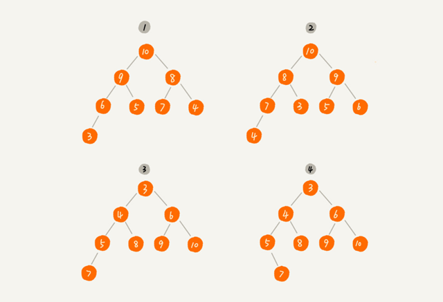

其中第$1$个和第 $2$ 个是大顶堆，第 $3$ 个是小顶堆，第 $4$ 个不是堆。除此之外，从图中还可以看出来，对于同一组数据，我们可以构建多种不同形态的堆。

## 如何实现一个堆？

要实现一个堆，我们先要知道，**堆都支持哪些操作**以及**如何存储一个堆**。

我之前讲过，完全二叉树比较适合用数组来存储。用数组来存储完全二叉树是非常节省存储空间的。因为我们不需要存储左右子节点的指针，单纯地通过数组的下标，就可以找到一个节点的左右子节点和父节点。

我画了一个用数组存储堆的例子，你可以先看下。

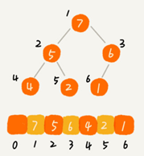

从图中我们可以看到，数组中下标为 $i$ 的节点的左子节点，就是下标为 $i∗2$ 的节点，右子节点就是下标为 $i∗2+1$的节点，父节点就是下标为 $\frac{i}{2}$ 的节点。

知道了如何存储一个堆，那我们再来看看，堆上的操作有哪些呢？我罗列了几个非常核心的操作，分别是往堆中插入一个元素和删除堆顶元素。（如果没有特殊说明，我下面都是拿大顶堆来讲解）。

### 1. 往堆中插入一个元素

往堆中插入一个元素后，我们需要继续满足堆的两个特性。

如果我们把新插入的元素放到堆的最后，你可以看我画的这个图，是不是不符合堆的特性了？于是，我们就需要进行调整，让其重新满足堆的特性，这个过程我们起了一个名字，就叫作**堆化**（heapify）。

堆化实际上有两种，从下往上和从上往下。这里我先讲**从下往上**的堆化方法。

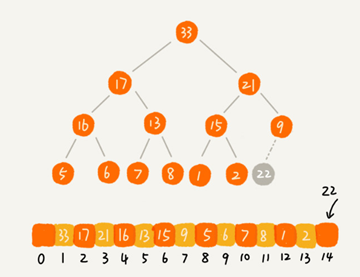

堆化非常简单，就是顺着节点所在的路径，向上或者向下，对比，然后交换。

我这里画了一张堆化的过程分解图。我们可以让新插入的节点与父节点对比大小。如果不满足子节点小于等于父节点的大小关系，我们就互换两个节点。一直重复这个过程，直到父子节点之间满足刚说的那种大小关系。

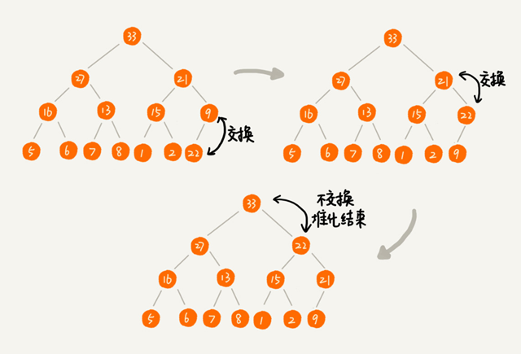

我将上面讲的往堆中插入数据的过程，翻译成了代码，你可以结合着一块看。

```java
public class Heap {
  private int[] a; // 数组，从下标 1 开始存储数据
  private int n;  // 堆可以存储的最大数据个数
  private int count; // 堆中已经存储的数据个数
 
  public Heap(int capacity) {
    a = new int[capacity + 1];
    n = capacity;
    count = 0;
  }
 
  public void insert(int data) {
    if (count >= n) return; // 堆满了
    ++count;
    a[count] = data;
    int i = count;
    while (i/2 > 0 && a[i] > a[i/2]) { // 自下往上堆化
      swap(a, i, i/2); // swap() 函数作用：交换下标为 i 和 i/2 的两个元素
      i = i/2;
    }
  }
 }
```

### 2. 删除堆顶元素

从堆的定义的第二条中，任何节点的值都大于等于（或小于等于）子树节点的值，我们可以发现，堆顶元素存储的就是堆中数据的最大值或者最小值。

假设我们构造的是大顶堆，堆顶元素就是最大的元素。当我们删除堆顶元素之后，就需要把第二大的元素放到堆顶，那第二大元素肯定会出现在左右子节点中。然后我们再迭代地删除第二大节点，以此类推，直到叶子节点被删除。

这里我也画了一个分解图。不过这种方法有点问题，就是最后堆化出来的堆并不满足完全二叉树的特性。

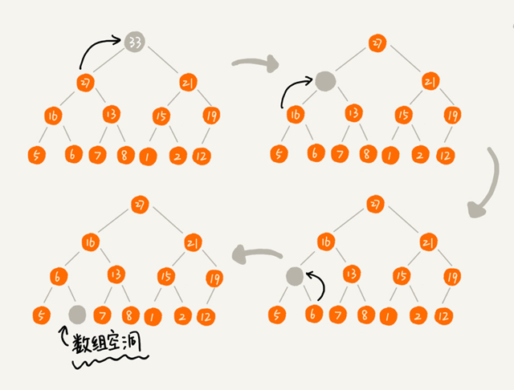

实际上，我们稍微改变一下思路，就可以解决这个问题。你看我画的下面这幅图。我们把最后一个节点放到堆顶，然后利用同样的父子节点对比方法。对于不满足父子节点大小关系的，互换两个节点，并且重复进行这个过程，直到父子节点之间满足大小关系为止。这就是**从上往下的堆化方法**。

因为我们移除的是数组中的最后一个元素，而在堆化的过程中，都是交换操作，不会出现数组中的“空洞”，所以这种方法堆化之后的结果，肯定满足完全二叉树的特性。

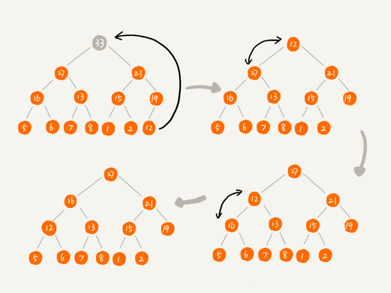

我把上面的删除过程同样也翻译成了代码，贴在这里，你可以结合着看。

```java
public void removeMax() {
  if (count == 0) return -1; // 堆中没有数据
  a[1] = a[count];
  --count;
  heapify(a, count, 1);
}
 
private void heapify(int[] a, int n, int i) { // 自上往下堆化
  while (true) {
    int maxPos = i;
    if (i*2 <= n && a[i] < a[i*2]) maxPos = i*2;
    if (i*2+1 <= n && a[maxPos] < a[i*2+1]) maxPos = i*2+1;
    if (maxPos == i) break;
    swap(a, i, maxPos);
    i = maxPos;
  }
}
```

我们知道，一个包含 $n$ 个节点的完全二叉树，树的高度不会超过 $log_{2}n$。堆化的过程是顺着节点所在路径比较交换的，所以堆化的时间复杂度跟树的高度成正比，也就是 $O(log\ n)$。插入数据和删除堆顶元素的主要逻辑就是堆化，所以，往堆中插入一个元素和删除堆顶元素的时间复杂度都是 $O(log\ n)$。

## 如何基于堆实现排序？

前面我们讲过好几种排序算法，我们再来回忆一下，有时间复杂度是 $O(n^2)$ 的冒泡排序、插入排序、选择排序，有时间复杂度是 $O(nlog\  n)$ 的归并排序、快速排序，还有线性排序。

这里我们借助于堆这种数据结构实现的排序算法，就叫作堆排序。这种排序方法的时间复杂度非常稳定，是 $O(nlog\  n)$，并且它还是原地排序算法。如此优秀，它是怎么做到的呢？

我们可以把堆排序的过程大致分解成两个大的步骤，**建堆**和**排序**。

### 1. 建堆

我们首先将数组原地建成一个堆。所谓“原地”就是，不借助另一个数组，就在原数组上操作。建堆的过程，有两种思路。

第一种是借助我们前面讲的，在堆中插入一个元素的思路。尽管数组中包含$n$ 个数据，但是我们可以假设，起初堆中只包含一个数据，就是下标为 $1$ 的数据。然后，我们调用前面讲的插入操作，将下标从 $2$ 到 $n$ 的数据依次插入到堆中。这样我们就将包含 $n$ 个数据的数组，组织成了堆。

第二种实现思路，跟第一种截然相反，也是我这里要详细讲的。第一种建堆思路的处理过程是从前往后处理数组数据，并且每个数据插入堆中时，都是从下往上堆化。而第二种实现思路，是从后往前处理数组，并且每个数据都是从上往下堆化。

我举了一个例子，并且画了一个第二种实现思路的建堆分解步骤图，你可以看下。因为叶子节点往下堆化只能自己跟自己比较，所以我们直接从第一个非叶子节点开始，依次堆化就行了。

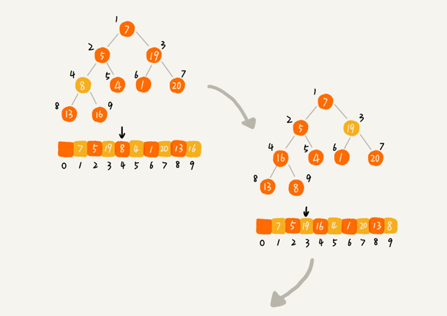

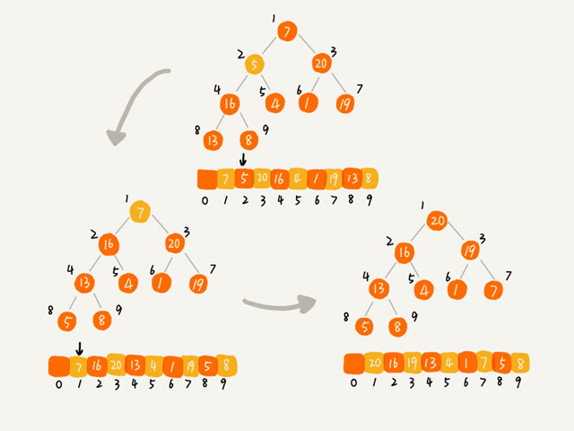

对于程序员来说，看代码可能更好理解一些，所以，我将第二种实现思路翻译成了代码，你可以看下。

```java
private static void buildHeap(int[] a, int n) {
  for (int i = n/2; i >= 1; --i) {
    heapify(a, n, i);
  }
}
 
private static void heapify(int[] a, int n, int i) {
  while (true) {
    int maxPos = i;
    if (i*2 <= n && a[i] < a[i*2]) maxPos = i*2;
    if (i*2+1 <= n && a[maxPos] < a[i*2+1]) maxPos = i*2+1;
    if (maxPos == i) break;
    swap(a, i, maxPos);
    i = maxPos;
  }
}
```

你可能已经发现了，在这段代码中，我们对下标从 $\frac{n}{2}$ 开始到 $1$ 的数据进行堆化，下标是 $\frac{n}{2}+1$ 到 $n$ 的节点是叶子节点，我们不需要堆化。实际上，对于完全二叉树来说，下标从$\frac{n}{2}+1$到 $n$ 的节点都是叶子节点。

现在，我们来看，建堆操作的时间复杂度是多少呢？

每个节点堆化的时间复杂度是$O(log\ n)$，那 $\frac{n}{2}+1$ 个节点堆化的总时间复杂度是不是就是 $O(nlog\  n)$ 呢？这个答案虽然也没错，但是这个值还是不够精确。实际上，堆排序的建堆过程的时间复杂度是 $O(n)$。我带你推导一下。

因为叶子节点不需要堆化，所以需要堆化的节点从倒数第二层开始。每个节点堆化的过程中，需要比较和交换的节点个数，跟这个节点的高度 $k$ 成正比。

我把每一层的节点个数和对应的高度画了出来，你可以看看。我们只需要将每个节点的高度求和，得出的就是建堆的时间复杂度。

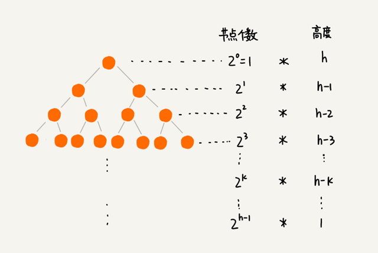

我们将每个非叶子节点的高度求和，就是下面这个公式：
$$
S_{1}=1 * h+2^{1} *(h-1)+2^{2} *(h-2)+\cdots+2^{k} *(h-k)+\cdots+2^{h-1} * 1
$$
这个公式的求解稍微有点技巧，不过我们高中应该都学过：把公式左右都乘以 $2$，就得到另一个公式 $S2$。我们将 $S2$ 错位对齐，并且用 $S2$ 减去 $S1$，可以得到 $S$。

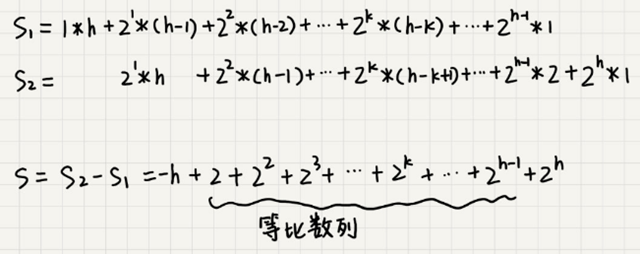

$S$ 的中间部分是一个等比数列，所以最后可以用等比数列的求和公式来计算，最终的结果就是下面图中画的这个样子。
$$
S=-h+\left(2^{h}-2\right)+2^{h}=2^{h+1}-h-2
$$
因为 $h=log_2 n$，代入公式 $S$，就能得到 $S=O(n)$，所以，建堆的时间复杂度就是 $O(n)$。

### 2. 排序

建堆结束之后，数组中的数据已经是按照大顶堆的特性来组织的。数组中的第一个元素就是堆顶，也就是最大的元素。我们把它跟最后一个元素交换，那最大元素就放到了下标为 $n$ 的位置。

这个过程有点类似上面讲的“删除堆顶元素”的操作，当堆顶元素移除之后，我们把下标为 $n$的元素放到堆顶，然后再通过堆化的方法，将剩下的 $n−1$ 个元素重新构建成堆。堆化完成之后，我们再取堆顶的元素，放到下标是 $n−1$ 的位置，一直重复这个过程，直到最后堆中只剩下标为 $1$ 的一个元素，排序工作就完成了。

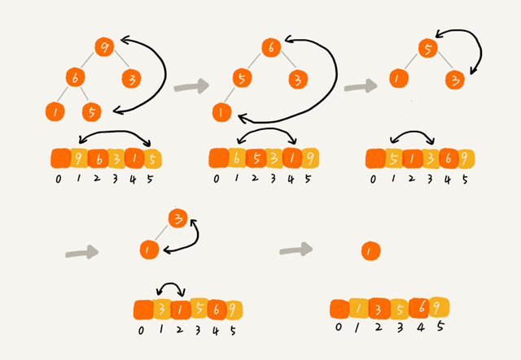

堆排序的过程，我也翻译成了代码。结合着代码看，你理解起来应该会更加容易。

```java
// n 表示数据的个数，数组 a 中的数据从下标 1 到 n 的位置。
public static void sort(int[] a, int n) {
  buildHeap(a, n);
  int k = n;
  while (k > 1) {
    swap(a, 1, k);
    --k;
    heapify(a, k, 1);
  }
}
```

现在，我们再来分析一下堆排序的时间复杂度、空间复杂度以及稳定性。

整个堆排序的过程，都只需要极个别临时存储空间，所以堆排序是原地排序算法。堆排序包括建堆和排序两个操作，建堆过程的时间复杂度是 $O(n)$，排序过程的时间复杂度是 $O(nlog \  n)$，所以，堆排序整体的时间复杂度是 $O(nlog \  n)$。

堆排序不是稳定的排序算法，因为在排序的过程，存在将堆的最后一个节点跟堆顶节点互换的操作，所以就有可能改变值相同数据的原始相对顺序。

今天的内容到此就讲完了。我这里要稍微解释一下，在前面的讲解以及代码中，我都假设，堆中的数据是从数组下标为 1 的位置开始存储。那如果从 $0$ 开始存储，实际上处理思路是没有任何变化的，唯一变化的，可能就是，代码实现的时候，计算子节点和父节点的下标的公式改变了。

如果节点的下标是 ii，那左子节点的下标就是 $2∗i+1$，右子节点的下标就是 $2∗i+2$，父节点的下标就是 $\frac{i-1}{2}$。

## 解答开篇

现在我们来看开篇的问题，在实际开发中，为什么快速排序要比堆排序性能好？

我觉得主要有两方面的原因。

**第一点，堆排序数据访问的方式没有快速排序友好。**

对于快速排序来说，数据是顺序访问的。而对于堆排序来说，数据是跳着访问的。 比如，堆排序中，最重要的一个操作就是数据的堆化。比如下面这个例子，对堆顶节点进行堆化，会依次访问数组下标是 $1，2，4，8$的元素，而不是像快速排序那样，局部顺序访问，所以，这样对 CPU 缓存是不友好的。

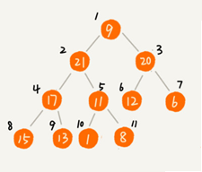

**第二点，对于同样的数据，在排序过程中，堆排序算法的数据交换次数要多于快速排序。**

我们在讲排序的时候，提过两个概念，有序度和逆序度。对于基于比较的排序算法来说，整个排序过程就是由两个基本的操作组成的，比较和交换（或移动）。快速排序数据交换的次数不会比逆序度多。

但是堆排序的第一步是建堆，建堆的过程会打乱数据原有的相对先后顺序，导致原数据的有序度降低。比如，对于一组已经有序的数据来说，经过建堆之后，数据反而变得更无序了。

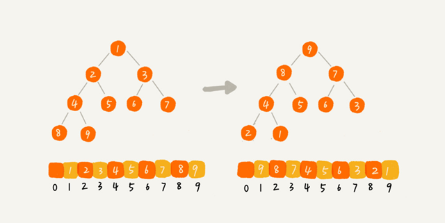

对于第二点，你可以自己做个试验看下。我们用一个记录交换次数的变量，在代码中，每次交换的时候，我们就对这个变量加一，排序完成之后，这个变量的值就是总的数据交换次数。这样你就能很直观地理解我刚刚说的，堆排序比快速排序交换次数多。

## 内容小结

今天我们讲了堆这种数据结构。堆是一种完全二叉树。它最大的特性是：每个节点的值都大于等于（或小于等于）其子树节点的值。因此，堆被分成了两类，大顶堆和小顶堆。

堆中比较重要的两个操作是插入一个数据和删除堆顶元素。这两个操作都要用到堆化。插入一个数据的时候，我们把新插入的数据放到数组的最后，然后从下往上堆化；删除堆顶数据的时候，我们把数组中的最后一个元素放到堆顶，然后从上往下堆化。这两个操作时间复杂度都是 $O(log \  n)$。

除此之外，我们还讲了堆的一个经典应用，堆排序。堆排序包含两个过程，建堆和排序。我们将下标从$\frac{n}{2}$ 到 $1$ 的节点，依次进行从上到下的堆化操作，然后就可以将数组中的数据组织成堆这种数据结构。接下来，我们迭代地将堆顶的元素放到堆的末尾，并将堆的大小减一，然后再堆化，重复这个过程，直到堆中只剩下一个元素，整个数组中的数据就都有序排列了。

## 课后思考

1. 在讲堆排序建堆的时候，我说到，对于完全二叉树来说，下标从 $\frac{n}{2}+1$ 到 $n$ 的都是叶子节点，这个结论是怎么推导出来的呢？
2. 我们今天讲了堆的一种经典应用，堆排序。关于堆，你还能想到它的其他应用吗？

# 堆的应用：如何快速获取到Top 10最热门的搜索关键词？

搜索引擎的热门搜索排行榜功能你用过吗？你知道这个功能是如何实现的吗？实际上，它的实现并不复杂。搜索引擎每天会接收大量的用户搜索请求，它会把这些用户输入的搜索关键词记录下来，然后再离线地统计分析，得到最热门的 Top 10 搜索关键词。

那请你思考下，**假设现在我们有一个包含 10 亿个搜索关键词的日志文件，如何能快速获取到热门榜 Top 10 的搜索关键词呢？**

这个问题就可以用堆来解决，这也是堆这种数据结构一个非常典型的应用。上一节我们讲了堆和堆排序的一些理论知识，今天我们就来讲一讲，堆这种数据结构几个非常重要的应用：优先级队列、求 Top K 和求中位数。

## 堆的应用一：优先级队列

首先，我们来看第一个应用场景：优先级队列。

优先级队列，顾名思义，它首先应该是一个队列。我们前面讲过，队列最大的特性就是先进先出。不过，在优先级队列中，数据的出队顺序不是先进先出，而是按照优先级来，优先级最高的，最先出队。

如何实现一个优先级队列呢？方法有很多，但是用堆来实现是最直接、最高效的。这是因为，堆和优先级队列非常相似。一个堆就可以看作一个优先级队列。很多时候，它们只是概念上的区分而已。往优先级队列中插入一个元素，就相当于往堆中插入一个元素；从优先级队列中取出优先级最高的元素，就相当于取出堆顶元素。

你可别小看这个优先级队列，它的应用场景非常多。我们后面要讲的很多数据结构和算法都要依赖它。比如，赫夫曼编码、图的最短路径、最小生成树算法等等。不仅如此，很多语言中，都提供了优先级队列的实现，比如，Java 的 PriorityQueue，C++ 的 priority_queue 等。

只讲这些应用场景比较空泛，现在，我举两个具体的例子，让你感受一下优先级队列具体是怎么用的。

### 1. 合并有序小文件

假设我们有 100 个小文件，每个文件的大小是 100MB，每个文件中存储的都是有序的字符串。我们希望将这些 100 个小文件合并成一个有序的大文件。这里就会用到优先级队列。

整体思路有点像归并排序中的合并函数。我们从这 100 个文件中，各取第一个字符串，放入数组中，然后比较大小，把最小的那个字符串放入合并后的大文件中，并从数组中删除。

假设，这个最小的字符串来自于 13.txt 这个小文件，我们就再从这个小文件取下一个字符串，并且放到数组中，重新比较大小，并且选择最小的放入合并后的大文件，并且将它从数组中删除。依次类推，直到所有的文件中的数据都放入到大文件为止。

这里我们用数组这种数据结构，来存储从小文件中取出来的字符串。每次从数组中取最小字符串，都需要循环遍历整个数组，显然，这不是很高效。有没有更加高效方法呢？

这里就可以用到优先级队列，也可以说是堆。我们将从小文件中取出来的字符串放入到小顶堆中，那堆顶的元素，也就是优先级队列队首的元素，就是最小的字符串。我们将这个字符串放入到大文件中，并将其从堆中删除。然后再从小文件中取出下一个字符串，放入到堆中。循环这个过程，就可以将 100 个小文件中的数据依次放入到大文件中。

我们知道，删除堆顶数据和往堆中插入数据的时间复杂度都是 O(logn)，n 表示堆中的数据个数，这里就是 100。是不是比原来数组存储的方式高效了很多呢？

### 2. 高性能定时器

假设我们有一个定时器，定时器中维护了很多定时任务，每个任务都设定了一个要触发执行的时间点。定时器每过一个很小的单位时间（比如 1 秒），就扫描一遍任务，看是否有任务到达设定的执行时间。如果到达了，就拿出来执行。

| 2018.11.28.  17:30 | Task A |
| ------------------ | ------ |
| 2018.11.28.  19:20 | Task B |
| 2018.11.28.  15:31 | Task C |
| 2018.11.28.  13:55 | Task D |

但是，这样每过 1 秒就扫描一遍任务列表的做法比较低效，主要原因有两点：第一，任务的约定执行时间离当前时间可能还有很久，这样前面很多次扫描其实都是徒劳的；第二，每次都要扫描整个任务列表，如果任务列表很大的话，势必会比较耗时。

针对这些问题，我们就可以用优先级队列来解决。我们按照任务设定的执行时间，将这些任务存储在优先级队列中，队列首部（也就是小顶堆的堆顶）存储的是最先执行的任务。

这样，定时器就不需要每隔 1 秒就扫描一遍任务列表了。它拿队首任务的执行时间点，与当前时间点相减，得到一个时间间隔 T。

这个时间间隔 T 就是，从当前时间开始，需要等待多久，才会有第一个任务需要被执行。这样，定时器就可以设定在 T 秒之后，再来执行任务。从当前时间点到（T-1）秒这段时间里，定时器都不需要做任何事情。

当 T 秒时间过去之后，定时器取优先级队列中队首的任务执行。然后再计算新的队首任务的执行时间点与当前时间点的差值，把这个值作为定时器执行下一个任务需要等待的时间。

这样，定时器既不用间隔 1 秒就轮询一次，也不用遍历整个任务列表，性能也就提高了。

## 堆的应用二：利用堆求 Top K

刚刚我们学习了优先级队列，我们现在来看，堆的另外一个非常重要的应用场景，那就是“求 Top K 问题”。

我把这种求 Top K 的问题抽象成两类。一类是针对静态数据集合，也就是说数据集合事先确定，不会再变。另一类是针对动态数据集合，也就是说数据集合事先并不确定，有数据动态地加入到集合中。

针对静态数据，如何在一个包含 n 个数据的数组中，查找前 K 大数据呢？我们可以维护一个大小为 K 的小顶堆，顺序遍历数组，从数组中取出取数据与堆顶元素比较。如果比堆顶元素大，我们就把堆顶元素删除，并且将这个元素插入到堆中；如果比堆顶元素小，则不做处理，继续遍历数组。这样等数组中的数据都遍历完之后，堆中的数据就是前 K 大数据了。

遍历数组需要 O(n) 的时间复杂度，一次堆化操作需要 O(logK) 的时间复杂度，所以最坏情况下，n 个元素都入堆一次，所以时间复杂度就是 O(nlogK)。

针对动态数据求得 Top K 就是实时 Top K。怎么理解呢？我举一个例子。一个数据集合中有两个操作，一个是添加数据，另一个询问当前的前 K 大数据。

如果每次询问前 K 大数据，我们都基于当前的数据重新计算的话，那时间复杂度就是 O(nlogK)，n 表示当前的数据的大小。实际上，我们可以一直都维护一个 K 大小的小顶堆，当有数据被添加到集合中时，我们就拿它与堆顶的元素对比。如果比堆顶元素大，我们就把堆顶元素删除，并且将这个元素插入到堆中；如果比堆顶元素小，则不做处理。这样，无论任何时候需要查询当前的前 K 大数据，我们都可以里立刻返回给他。

## 堆的应用三：利用堆求中位数

前面我们讲了如何求 Top K 的问题，现在我们来讲下，如何求动态数据集合中的中位数。

中位数，顾名思义，就是处在中间位置的那个数。如果数据的个数是奇数，把数据从小到大排列，那第 $\frac{n}{2}+1$ 个数据就是中位数；如果数据的个数是偶数的话，那处于中间位置的数据有两个，第 $\frac{n}{2}$ 个和第 $\frac{n}{2}+1$ 个数据，这个时候，我们可以随意取一个作为中位数，比如取两个数中靠前的那个，就是第 $\frac{n}{2}$ 个数据。

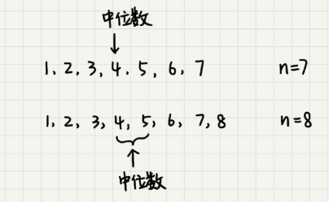

对于一组**静态数据**，中位数是固定的，我们可以先排序，第 $\frac{n}{2}$ 个数据就是中位数。每次询问中位数的时候，我们直接返回这个固定的值就好了。所以，尽管排序的代价比较大，但是边际成本会很小。但是，如果我们面对的是**动态数据**集合，中位数在不停地变动，如果再用先排序的方法，每次询问中位数的时候，都要先进行排序，那效率就不高了。

**借助堆这种数据结构，我们不用排序，就可以非常高效地实现求中位数操作。我们来看看，它是如何做到的？**

我们需要维护两个堆，一个大顶堆，一个小顶堆。大顶堆中存储前半部分数据，小顶堆中存储后半部分数据，且小顶堆中的数据都大于大顶堆中的数据。

也就是说，如果有 n 个数据，n 是偶数，我们从小到大排序，那前 $\frac{n}{2}$ 个数据存储在大顶堆中，后 $\frac{n}{2}$ 个数据存储在小顶堆中。这样，大顶堆中的堆顶元素就是我们要找的中位数。如果 n 是奇数，情况是类似的，大顶堆就存储 $\frac{n}{2}+1$ 个数据，小顶堆中就存储 $\frac{n}{2}$ 个数据。

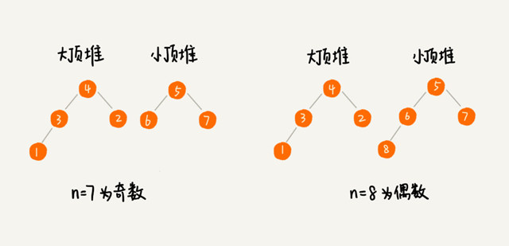

我们前面也提到，数据是动态变化的，当新添加一个数据的时候，我们如何调整两个堆，让大顶堆中的堆顶元素继续是中位数呢？

如果新加入的数据小于等于大顶堆的堆顶元素，我们就将这个新数据插入到大顶堆；如果新加入的数据大于等于小顶堆的堆顶元素，我们就将这个新数据插入到小顶堆。

这个时候就有可能出现，两个堆中的数据个数不符合前面约定的情况：如果 n 是偶数，两个堆中的数据个数都是 $\frac{n}{2}$；如果 n 是奇数，大顶堆有 $\frac{n}{2}+1$ 个数据，小顶堆有 $\frac{n}{2}$ 个数据。这个时候，我们可以从一个堆中不停地将堆顶元素移动到另一个堆，通过这样的调整，来让两个堆中的数据满足上面的约定。

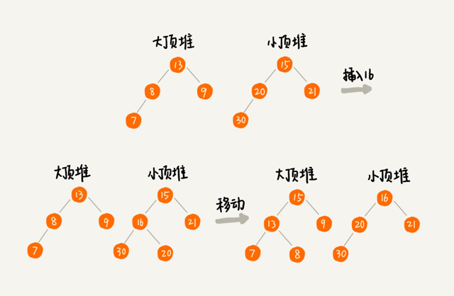

于是，我们就可以利用两个堆，一个大顶堆、一个小顶堆，实现在动态数据集合中求中位数的操作。插入数据因为需要涉及堆化，所以时间复杂度变成了 $O(logn)$，但是求中位数我们只需要返回大顶堆的堆顶元素就可以了，所以时间复杂度就是 $O(1)$。

实际上，利用两个堆不仅可以快速求出中位数，还可以快速求其他百分位的数据，原理是类似的。还记得“如何快速求接口的 99% 响应时间？"这个问题吗？我们现在就来看下，利用两个堆如何来实现。

在开始这个问题的讲解之前，我先解释一下，什么是“99% 响应时间”。

中位数的概念就是将数据从小到大排列，处于中间位置，就叫中位数，这个数据会大于等于前面 50% 的数据。99 百分位数的概念可以类比中位数，如果将一组数据从小到大排列，这个 99 百分位数就是大于前面 99% 数据的那个数据。

如果你还是不太理解，我再举个例子。假设有 100 个数据，分别是 1，2，3，……，100，那 99 百分位数就是 99，因为小于等于 99 的数占总个数的 99%。

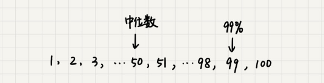

弄懂了这个概念，我们再来看 99% 响应时间。如果有 100 个接口访问请求，每个接口请求的响应时间都不同，比如 55 毫秒、100 毫秒、23 毫秒等，我们把这 100 个接口的响应时间按照从小到大排列，排在第 99 的那个数据就是 99% 响应时间，也叫 99 百分位响应时间。

我们总结一下，如果有 n 个数据，将数据从小到大排列之后，99 百分位数大约就是第 $n*99\%$ 个数据，同类，80 百分位数大约就是第 $n *80\%$ 个数据。

弄懂了这些，我们再来看如何求 99% 响应时间。

我们维护两个堆，一个大顶堆，一个小顶堆。假设当前总数据的个数是 n，大顶堆中保存 $n*99\%$ 个数据，小顶堆中保存 $n*1\%$ 个数据。大顶堆堆顶的数据就是我们要找的 99% 响应时间。

每次插入一个数据的时候，我们要判断这个数据跟大顶堆和小顶堆堆顶数据的大小关系，然后决定插入到哪个堆中。如果这个新插入的数据比大顶堆的堆顶数据小，那就插入大顶堆；如果这个新插入的数据比小顶堆的堆顶数据大，那就插入小顶堆。

但是，为了保持大顶堆中的数据占 99%，小顶堆中的数据占 1%，在每次新插入数据之后，我们都要重新计算，这个时候大顶堆和小顶堆中的数据个数，是否还符合 99:1 这个比例。如果不符合，我们就将一个堆中的数据移动到另一个堆，直到满足这个比例。移动的方法类似前面求中位数的方法，这里我就不啰嗦了。

通过这样的方法，每次插入数据，可能会涉及几个数据的堆化操作，所以时间复杂度是 O(logn)。每次求 99% 响应时间的时候，直接返回大顶堆中的堆顶数据即可，时间复杂度是 O(1)。

## 解答开篇

学懂了上面的一些应用场景的处理思路，我想你应该能解决开篇的那个问题了吧。假设现在我们有一个包含 10 亿个搜索关键词的日志文件，如何快速获取到 Top 10 最热门的搜索关键词呢？

处理这个问题，有很多高级的解决方法，比如使用 MapReduce 等。但是，如果我们将处理的场景限定为单机，可以使用的内存为 1GB。那这个问题该如何解决呢？

因为用户搜索的关键词，有很多可能都是重复的，所以我们首先要统计每个搜索关键词出现的频率。我们可以通过散列表、平衡二叉查找树或者其他一些支持快速查找、插入的数据结构，来记录关键词及其出现的次数。

假设我们选用散列表。我们就顺序扫描这 10 亿个搜索关键词。当扫描到某个关键词时，我们去散列表中查询。如果存在，我们就将对应的次数加一；如果不存在，我们就将它插入到散列表，并记录次数为 1。以此类推，等遍历完这 10 亿个搜索关键词之后，散列表中就存储了不重复的搜索关键词以及出现的次数。

然后，我们再根据前面讲的用堆求 Top K 的方法，建立一个大小为 10 的小顶堆，遍历散列表，依次取出每个搜索关键词及对应出现的次数，然后与堆顶的搜索关键词对比。如果出现次数比堆顶搜索关键词的次数多，那就删除堆顶的关键词，将这个出现次数更多的关键词加入到堆中。

以此类推，当遍历完整个散列表中的搜索关键词之后，堆中的搜索关键词就是出现次数最多的 Top 10 搜索关键词了。

不知道你发现了没有，上面的解决思路其实存在漏洞。10 亿的关键词还是很多的。我们假设 10 亿条搜索关键词中不重复的有 1 亿条，如果每个搜索关键词的平均长度是 50 个字节，那存储 1 亿个关键词起码需要 5GB 的内存空间，而散列表因为要避免频繁冲突，不会选择太大的装载因子，所以消耗的内存空间就更多了。而我们的机器只有 1GB 的可用内存空间，所以我们无法一次性将所有的搜索关键词加入到内存中。这个时候该怎么办呢？

我们在哈希算法那一节讲过，相同数据经过哈希算法得到的哈希值是一样的。我们可以哈希算法的这个特点，将 10 亿条搜索关键词先通过哈希算法分片到 10 个文件中。

具体可以这样做：我们创建 10 个空文件 00，01，02，……，09。我们遍历这 10 亿个关键词，并且通过某个哈希算法对其求哈希值，然后哈希值同 10 取模，得到的结果就是这个搜索关键词应该被分到的文件编号。

对这 10 亿个关键词分片之后，每个文件都只有 1 亿的关键词，去除掉重复的，可能就只有 1000 万个，每个关键词平均 50 个字节，所以总的大小就是 500MB。1GB 的内存完全可以放得下。

我们针对每个包含 1 亿条搜索关键词的文件，利用散列表和堆，分别求出 Top 10，然后把这个 10 个 Top 10 放在一块，然后取这 100 个关键词中，出现次数最多的 10 个关键词，这就是这 10 亿数据中的 Top 10 最频繁的搜索关键词了。

## 内容小结

我们今天主要讲了堆的几个重要的应用，它们分别是：优先级队列、求 Top K 问题和求中位数问题。

优先级队列是一种特殊的队列，优先级高的数据先出队，而不再像普通的队列那样，先进先出。实际上，堆就可以看作优先级队列，只是称谓不一样罢了。求 Top K 问题又可以分为针对静态数据和针对动态数据，只需要利用一个堆，就可以做到非常高效率的查询 Top K 的数据。求中位数实际上还有很多变形，比如求 99 百分位数据、90 百分位数据等，处理的思路都是一样的，即利用两个堆，一个大顶堆，一个小顶堆，随着数据的动态添加，动态调整两个堆中的数据，最后大顶堆的堆顶元素就是要求的数据。

## 课后思考

有一个访问量非常大的新闻网站，我们希望将点击量排名 Top 10 的新闻摘要，滚动显示在网站首页 banner 上，并且每隔 1 小时更新一次。如果你是负责开发这个功能的工程师，你会如何来实现呢？