# 字符串匹配基础（上）：如何借助哈希算法实现高效字符串匹配？

从今天开始，我们来学习字符串匹配算法。字符串匹配这样一个功能，我想对于任何一个开发工程师来说，应该都不会陌生。我们用的最多的就是编程语言提供的字符串查找函数，比如 Java 中的 indexOf()，Python 中的 find() 函数等，它们底层就是依赖接下来要讲的字符串匹配算法。

字符串匹配算法很多，我会分四节来讲解。今天我会讲两种比较简单的、好理解的，它们分别是：BF 算法和 RK 算法。下一节，我会讲两种比较难理解、但更加高效的，它们是：BM 算法和 KMP 算法。

这两节讲的都是单模式串匹配的算法，也就是一个串跟一个串进行匹配。第三节、第四节，我会讲两种多模式串匹配算法，也就是在一个串中同时查找多个串，它们分别是 Trie 树和 AC 自动机。

今天讲的两个算法中，RK 算法是 BF 算法的改进，它巧妙借助了我们前面讲过的哈希算法，让匹配的效率有了很大的提升。那**RK 算法是如何借助哈希算法来实现高效字符串匹配的呢**？你可以带着这个问题，来学习今天的内容。

## BF 算法

BF 算法中的 BF 是 Brute Force 的缩写，中文叫作暴力匹配算法，也叫朴素匹配算法。从名字可以看出，这种算法的字符串匹配方式很“暴力”，当然也就会比较简单、好懂，但相应的性能也不高。

在开始讲解这个算法之前，我先定义两个概念，方便我后面讲解。它们分别是**主串**和**模式串**。这俩概念很好理解，我举个例子你就懂了。

比方说，我们在字符串 A 中查找字符串 B，那字符串 A 就是主串，字符串 B 就是模式串。我们把主串的长度记作 n，模式串的长度记作 m。因为我们是在主串中查找模式串，所以 n>m。

作为最简单、最暴力的字符串匹配算法，BF 算法的思想可以用一句话来概括，那就是，**我们在主串中，检查起始位置分别是 0、1、2…n-m 且长度为 m 的 n-m+1 个子串，看有没有跟模式串匹配的**。我举一个例子给你看看，你应该可以理解得更清楚。

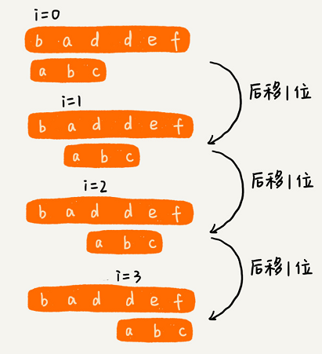

从上面的算法思想和例子，我们可以看出，在极端情况下，比如主串是“aaaaa…aaaaaa”（省略号表示有很多重复的字符 a），模式串是“aaaaab”。我们每次都比对 m 个字符，要比对 n-m+1 次，所以，这种算法的最坏情况时间复杂度是 O(n*m)。

尽管理论上，BF 算法的时间复杂度很高，是 O(n*m)，但在实际的开发中，它却是一个比较常用的字符串匹配算法。为什么这么说呢？原因有两点。

第一，实际的软件开发中，大部分情况下，模式串和主串的长度都不会太长。而且每次模式串与主串中的子串匹配的时候，当中途遇到不能匹配的字符的时候，就可以就停止了，不需要把 m 个字符都比对一下。所以，尽管理论上的最坏情况时间复杂度是 O(n*m)，但是，统计意义上，大部分情况下，算法执行效率要比这个高很多。

第二，朴素字符串匹配算法思想简单，代码实现也非常简单。简单意味着不容易出错，如果有 bug 也容易暴露和修复。在工程中，在满足性能要求的前提下，简单是首选。这也是我们常说的[KISS（Keep it Simple and Stupid）设计原则](https://zh.wikipedia.org/wiki/KISS原则)。

所以，在实际的软件开发中，绝大部分情况下，朴素的字符串匹配算法就够用了。

## RK 算法

RK 算法的全称叫 Rabin-Karp 算法，是由它的两位发明者 Rabin 和 Karp 的名字来命名的。这个算法理解起来也不是很难。我个人觉得，它其实就是刚刚讲的 BF 算法的升级版。

我在讲 BF 算法的时候讲过，如果模式串长度为 m，主串长度为 n，那在主串中，就会有 n-m+1 个长度为 m 的子串，我们只需要暴力地对比这 n-m+1 个子串与模式串，就可以找出主串与模式串匹配的子串。

但是，每次检查主串与子串是否匹配，需要依次比对每个字符，所以 BF 算法的时间复杂度就比较高，是 O(n*m)。我们对朴素的字符串匹配算法稍加改造，引入哈希算法，时间复杂度立刻就会降低。

RK 算法的思路是这样的：我们通过哈希算法对主串中的 n-m+1 个子串分别求哈希值，然后逐个与模式串的哈希值比较大小。如果某个子串的哈希值与模式串相等，那就说明对应的子串和模式串匹配了（这里先不考虑哈希冲突的问题，后面我们会讲到）。因为哈希值是一个数字，数字之间比较是否相等是非常快速的，所以模式串和子串比较的效率就提高了。

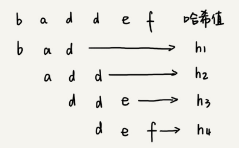

不过，通过哈希算法计算子串的哈希值的时候，我们需要遍历子串中的每个字符。尽管模式串与子串比较的效率提高了，但是，算法整体的效率并没有提高。有没有方法可以提高哈希算法计算子串哈希值的效率呢？

这就需要哈希算法设计的非常有技巧了。我们假设要匹配的字符串的字符集中只包含 K 个字符，我们可以用一个 K 进制数来表示一个子串，这个 K 进制数转化成十进制数，作为子串的哈希值。表述起来有点抽象，我举了一个例子，看完你应该就能懂了。

比如要处理的字符串只包含 a～z 这 26 个小写字母，那我们就用二十六进制来表示一个字符串。我们把 a～z 这 26 个字符映射到 0～25 这 26 个数字，a 就表示 0，b 就表示 1，以此类推，z 表示 25。

在十进制的表示法中，一个数字的值是通过下面的方式计算出来的。对应到二十六进制，一个包含 a 到 z 这 26 个字符的字符串，计算哈希的时候，我们只需要把进位从 10 改成 26 就可以。

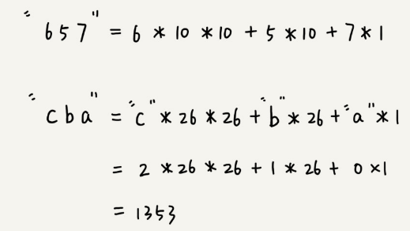

这个哈希算法你应该看懂了吧？现在，为了方便解释，在下面的讲解中，我假设字符串中只包含 a～z 这 26 个小写字符，我们用二十六进制来表示一个字符串，对应的哈希值就是二十六进制数转化成十进制的结果。

这种哈希算法有一个特点，在主串中，相邻两个子串的哈希值的计算公式有一定关系。我这有个个例子，你先找一下规律，再来看我后面的讲解。

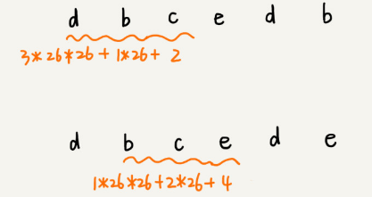

从这里例子中，我们很容易就能得出这样的规律：相邻两个子串 s[i-1] 和 s[i]（i 表示子串在主串中的起始位置，子串的长度都为 m），对应的哈希值计算公式有交集，也就是说，我们可以使用 s[i-1] 的哈希值很快的计算出 s[i] 的哈希值。如果用公式表示的话，就是下面这个样子：

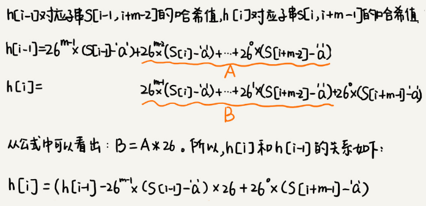

不过，这里有一个小细节需要注意，那就是 26^(m-1) 这部分的计算，我们可以通过查表的方法来提高效率。我们事先计算好 26^0、26^1、26^2……26^(m-1)，并且存储在一个长度为 m 的数组中，公式中的“次方”就对应数组的下标。当我们需要计算 26 的 x 次方的时候，就可以从数组的下标为 x 的位置取值，直接使用，省去了计算的时间。


我们开头的时候提过，RK 算法的效率要比 BF 算法高，现在，我们就来分析一下，RK 算法的时间复杂度到底是多少呢？

整个 RK 算法包含两部分，计算子串哈希值和模式串哈希值与子串哈希值之间的比较。第一部分，我们前面也分析了，可以通过设计特殊的哈希算法，只需要扫描一遍主串就能计算出所有子串的哈希值了，所以这部分的时间复杂度是 O(n)。

模式串哈希值与每个子串哈希值之间的比较的时间复杂度是 O(1)，总共需要比较 n-m+1 个子串的哈希值，所以，这部分的时间复杂度也是 O(n)。所以，RK 算法整体的时间复杂度就是 O(n)。

这里还有一个问题就是，模式串很长，相应的主串中的子串也会很长，通过上面的哈希算法计算得到的哈希值就可能很大，如果超过了计算机中整型数据可以表示的范围，那该如何解决呢？

刚刚我们设计的哈希算法是没有散列冲突的，也就是说，一个字符串与一个二十六进制数一一对应，不同的字符串的哈希值肯定不一样。因为我们是基于进制来表示一个字符串的，你可以类比成十进制、十六进制来思考一下。实际上，我们为了能将哈希值落在整型数据范围内，可以牺牲一下，允许哈希冲突。这个时候哈希算法该如何设计呢？

哈希算法的设计方法有很多，我举一个例子说明一下。假设字符串中只包含 a～z 这 26 个英文字母，那我们每个字母对应一个数字，比如 a 对应 1，b 对应 2，以此类推，z 对应 26。我们可以把字符串中每个字母对应的数字相加，最后得到的和作为哈希值。这种哈希算法产生的哈希值的数据范围就相对要小很多了。

不过，你也应该发现，这种哈希算法的哈希冲突概率也是挺高的。当然，我只是举了一个最简单的设计方法，还有很多更加优化的方法，比如将每一个字母从小到大对应一个素数，而不是 1，2，3……这样的自然数，这样冲突的概率就会降低一些。

那现在新的问题来了。之前我们只需要比较一下模式串和子串的哈希值，如果两个值相等，那这个子串就一定可以匹配模式串。但是，当存在哈希冲突的时候，有可能存在这样的情况，子串和模式串的哈希值虽然是相同的，但是两者本身并不匹配。

实际上，解决方法很简单。当我们发现一个子串的哈希值跟模式串的哈希值相等的时候，我们只需要再对比一下子串和模式串本身就好了。当然，如果子串的哈希值与模式串的哈希值不相等，那对应的子串和模式串肯定也是不匹配的，就不需要比对子串和模式串本身了。

所以，哈希算法的冲突概率要相对控制得低一些，如果存在大量冲突，就会导致 RK 算法的时间复杂度退化，效率下降。极端情况下，如果存在大量的冲突，每次都要再对比子串和模式串本身，那时间复杂度就会退化成 O(n*m)。但也不要太悲观，一般情况下，冲突不会很多，RK 算法的效率还是比 BF 算法高的。

## 解答开篇 & 内容小结

今天我们讲了两种字符串匹配算法，BF 算法和 RK 算法。

BF 算法是最简单、粗暴的字符串匹配算法，它的实现思路是，拿模式串与主串中是所有子串匹配，看是否有能匹配的子串。所以，时间复杂度也比较高，是 O(n*m)，n、m 表示主串和模式串的长度。不过，在实际的软件开发中，因为这种算法实现简单，对于处理小规模的字符串匹配很好用。

RK 算法是借助哈希算法对 BF 算法进行改造，即对每个子串分别求哈希值，然后拿子串的哈希值与模式串的哈希值比较，减少了比较的时间。所以，理想情况下，RK 算法的时间复杂度是 O(n)，跟 BF 算法相比，效率提高了很多。不过这样的效率取决于哈希算法的设计方法，如果存在冲突的情况下，时间复杂度可能会退化。极端情况下，哈希算法大量冲突，时间复杂度就退化为 O(n*m)。

## 课后思考

我们今天讲的都是一维字符串的匹配方法，实际上，这两种算法都可以类比到二维空间。假设有下面这样一个二维字符串矩阵（图中的主串），借助今天讲的处理思路，如何在其中查找另一个二维字符串矩阵（图中的模式串）呢？

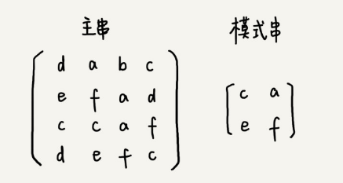

# 字符串匹配基础（中）：如何实现文本编辑器中的查找功能？

文本编辑器中的查找替换功能，我想你应该不陌生吧？比如，我们在 Word 中把一个单词统一替换成另一个，用的就是这个功能。你有没有想过，它是怎么实现的呢？

当然，你用上一节讲的 BF 算法和 RK 算法，也可以实现这个功能，但是在某些极端情况下，BF 算法性能会退化的比较严重，而 RK 算法需要用到哈希算法，而设计一个可以应对各种类型字符的哈希算法并不简单。

对于工业级的软件开发来说，我们希望算法尽可能的高效，并且在极端情况下，性能也不要退化的太严重。那么，**对于查找功能是重要功能的软件来说，比如一些文本编辑器，它们的查找功能都是用哪种算法来实现的呢？有没有比 BF 算法和 RK 算法更加高效的字符串匹配算法呢？**

今天，我们就来学习 BM（Boyer-Moore）算法。它是一种非常高效的字符串匹配算法，有实验统计，它的性能是著名的[KMP 算法](https://zh.wikipedia.org/wiki/克努斯-莫里斯-普拉特算法)的 3 到 4 倍**。**BM 算法的原理很复杂，比较难懂，学起来会比较烧脑，我会尽量给你讲清楚，同时也希望你做好打硬仗的准备。好，现在我们正式开始！

## BM 算法的核心思想

我们把模式串和主串的匹配过程，看作模式串在主串中不停地往后滑动。当遇到不匹配的字符时，BF 算法和 RK 算法的做法是，模式串往后滑动一位，然后从模式串的第一个字符开始重新匹配。我举个例子解释一下，你可以看我画的这幅图。

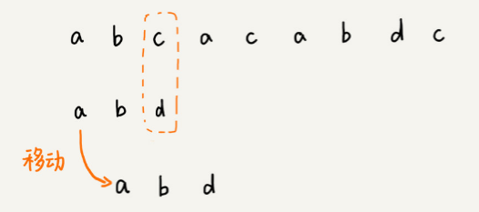

在这个例子里，主串中的 c，在模式串中是不存在的，所以，模式串向后滑动的时候，只要 c 与模式串有重合，肯定无法匹配。所以，我们可以一次性把模式串往后多滑动几位，把模式串移动到 c 的后面。

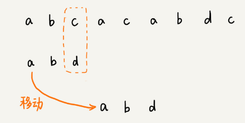

由现象找规律，你可以思考一下，当遇到不匹配的字符时，有什么固定的规律，可以将模式串往后多滑动几位呢？这样一次性往后滑动好几位，那匹配的效率岂不是就提高了？

我们今天要讲的 BM 算法，本质上其实就是在寻找这种规律。借助这种规律，在模式串与主串匹配的过程中，当模式串和主串某个字符不匹配的时候，能够跳过一些肯定不会匹配的情况，将模式串往后多滑动几位。

## BM 算法原理分析

BM 算法包含两部分，分别是**坏字符规则**（bad character rule）和**好后缀规则**（good suffix shift）。我们下面依次来看，这两个规则分别都是怎么工作的。

### 1. 坏字符规则

前面两节讲的算法，在匹配的过程中，我们都是按模式串的下标从小到大的顺序，依次与主串中的字符进行匹配的。这种匹配顺序比较符合我们的思维习惯，而 BM 算法的匹配顺序比较特别，它是按照模式串下标从大到小的顺序，倒着匹配的。我画了一张图，你可以看下。

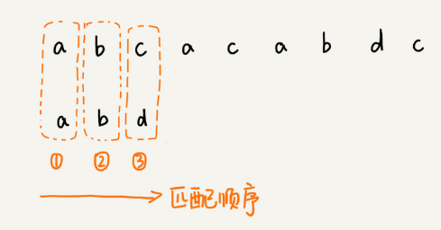

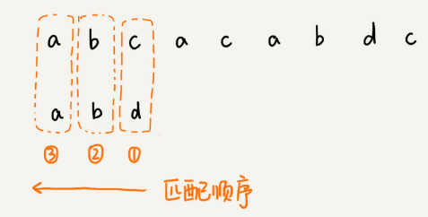

我们从模式串的末尾往前倒着匹配，当我们发现某个字符没法匹配的时候。我们把这个没有匹配的字符叫作**坏字符**（主串中的字符）。

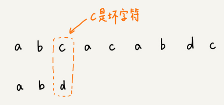

我们拿坏字符 c 在模式串中查找，发现模式串中并不存在这个字符，也就是说，字符 c 与模式串中的任何字符都不可能匹配。这个时候，我们可以将模式串直接往后滑动三位，将模式串滑动到 c 后面的位置，再从模式串的末尾字符开始比较。

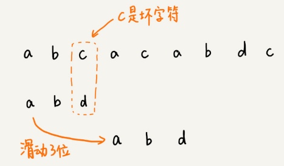

这个时候，我们发现，模式串中最后一个字符 d，还是无法跟主串中的 a 匹配，这个时候，还能将模式串往后滑动三位吗？答案是不行的。因为这个时候，坏字符 a 在模式串中是存在的，模式串中下标是 0 的位置也是字符 a。这种情况下，我们可以将模式串往后滑动两位，让两个 a 上下对齐，然后再从模式串的末尾字符开始，重新匹配。

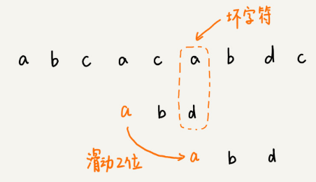

第一次不匹配的时候，我们滑动了三位，第二次不匹配的时候，我们将模式串后移两位，那具体滑动多少位，到底有没有规律呢？

当发生不匹配的时候，我们把坏字符对应的模式串中的字符下标记作 si。如果坏字符在模式串中存在，我们把这个坏字符在模式串中的下标记作 xi。如果不存在，我们把 xi 记作 -1。那模式串往后移动的位数就等于 si-xi。（注意，我这里说的下标，都是字符在模式串的下标）。

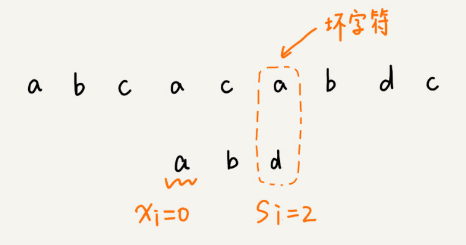

这里我要特别说明一点，如果坏字符在模式串里多处出现，那我们在计算 xi 的时候，选择最靠后的那个，因为这样不会让模式串滑动过多，导致本来可能匹配的情况被滑动略过。

利用坏字符规则，BM 算法在最好情况下的时间复杂度非常低，是 O(n/m)。比如，主串是 aaabaaabaaabaaab，模式串是 aaaa。每次比对，模式串都可以直接后移四位，所以，匹配具有类似特点的模式串和主串的时候，BM 算法非常高效。

不过，单纯使用坏字符规则还是不够的。因为根据 si-xi 计算出来的移动位数，有可能是负数，比如主串是 aaaaaaaaaaaaaaaa，模式串是 baaa。不但不会向后滑动模式串，还有可能倒退。所以，BM 算法还需要用到“好后缀规则”。

### 2. 好后缀规则

好后缀规则实际上跟坏字符规则的思路很类似。你看我下面这幅图。当模式串滑动到图中的位置的时候，模式串和主串有 2 个字符是匹配的，倒数第 3 个字符发生了不匹配的情况。

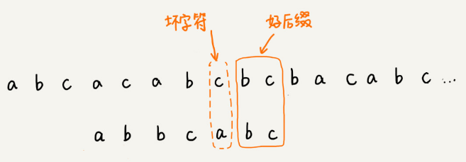

这个时候该如何滑动模式串呢？当然，我们还可以利用坏字符规则来计算模式串的滑动位数，不过，我们也可以使用好后缀处理规则。两种规则到底如何选择，我稍后会讲。抛开这个问题，现在我们来看，好后缀规则是怎么工作的？

我们把已经匹配的 bc 叫作好后缀，记作{u}。我们拿它在模式串中查找，如果找到了另一个跟{u}相匹配的子串{u*}，那我们就将模式串滑动到子串{u*}与主串中{u}对齐的位置。

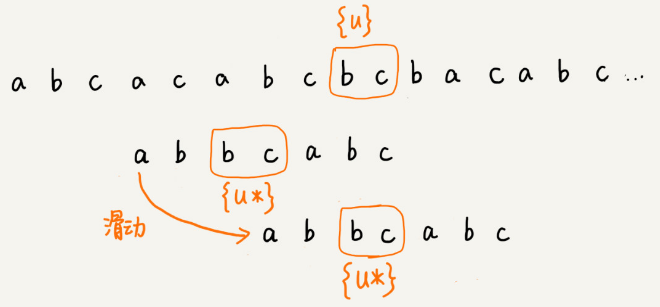

如果在模式串中找不到另一个等于{u}的子串，我们就直接将模式串，滑动到主串中{u}的后面，因为之前的任何一次往后滑动，都没有匹配主串中{u}的情况。

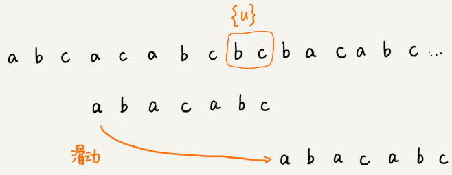

不过，当模式串中不存在等于{u}的子串时，我们直接将模式串滑动到主串{u}的后面。这样做是否有点太过头呢？我们来看下面这个例子。这里面 bc 是好后缀，尽管在模式串中没有另外一个相匹配的子串{u*}，但是如果我们将模式串移动到好后缀的后面，如图所示，那就会错过模式串和主串可以匹配的情况。

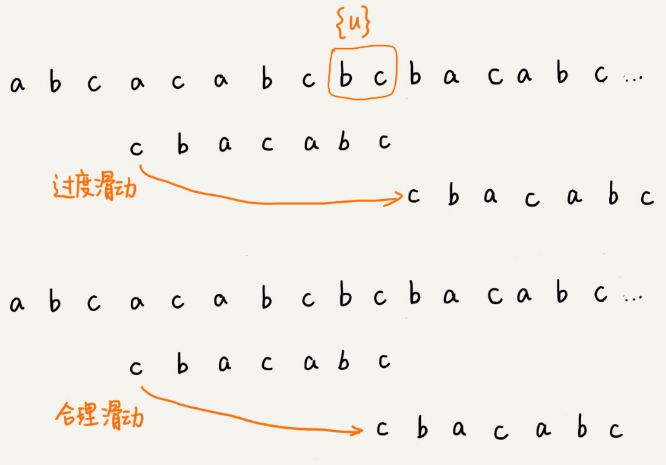

如果好后缀在模式串中不存在可匹配的子串，那在我们一步一步往后滑动模式串的过程中，只要主串中的{u}与模式串有重合，那肯定就无法完全匹配。但是当模式串滑动到前缀与主串中{u}的后缀有部分重合的时候，并且重合的部分相等的时候，就有可能会存在完全匹配的情况。

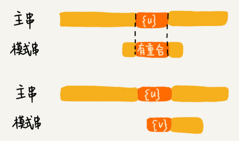

所以，针对这种情况，我们不仅要看好后缀在模式串中，是否有另一个匹配的子串，我们还要考察好后缀的后缀子串，是否存在跟模式串的前缀子串匹配的。

所谓某个字符串 s 的后缀子串，就是最后一个字符跟 s 对齐的子串，比如 abc 的后缀子串就包括 c, bc。所谓前缀子串，就是起始字符跟 s 对齐的子串，比如 abc 的前缀子串有 a，ab。我们从好后缀的后缀子串中，找一个最长的并且能跟模式串的前缀子串匹配的，假设是{v}，然后将模式串滑动到如图所示的位置。

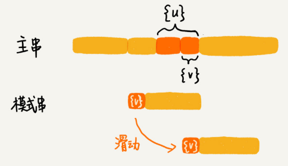

坏字符和好后缀的基本原理都讲完了，我现在回答一下前面那个问题。当模式串和主串中的某个字符不匹配的时候，如何选择用好后缀规则还是坏字符规则，来计算模式串往后滑动的位数？

我们可以分别计算好后缀和坏字符往后滑动的位数，然后取两个数中最大的，作为模式串往后滑动的位数。这种处理方法还可以避免我们前面提到的，根据坏字符规则，计算得到的往后滑动的位数，有可能是负数的情况。

## BM 算法代码实现

学习完了基本原理，我们再来看，如何实现 BM 算法？

“坏字符规则”本身不难理解。当遇到坏字符时，要计算往后移动的位数 si-xi，其中 xi 的计算是重点，我们如何求得 xi 呢？或者说，如何查找坏字符在模式串中出现的位置呢？

如果我们拿坏字符，在模式串中顺序遍历查找，这样就会比较低效，势必影响这个算法的性能。有没有更加高效的方式呢？我们之前学的散列表，这里可以派上用场了。我们可以将模式串中的每个字符及其下标都存到散列表中。这样就可以快速找到坏字符在模式串的位置下标了。

关于这个散列表，我们只实现一种最简单的情况，假设字符串的字符集不是很大，每个字符长度是 1 字节，我们用大小为 256 的数组，来记录每个字符在模式串中出现的位置。数组的下标对应字符的 ASCII 码值，数组中存储这个字符在模式串中出现的位置。

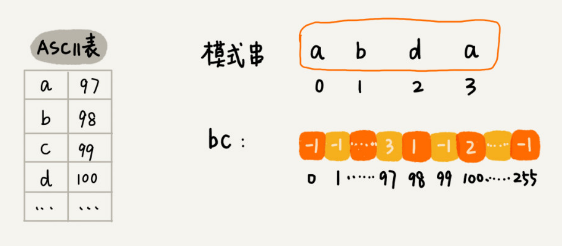

如果将上面的过程翻译成代码，就是下面这个样子。其中，变量 b 是模式串，m 是模式串的长度，bc 表示刚刚讲的散列表。

```java
private static final int SIZE = 256; // 全局变量或成员变量
private void generateBC(char[] b, int m, int[] bc) {
  for (int i = 0; i < SIZE; ++i) {
    bc[i] = -1; // 初始化 bc
  }
  for (int i = 0; i < m; ++i) {
    int ascii = (int)b[i]; // 计算 b[i] 的 ASCII 值
    bc[ascii] = i;
  }
}
```

掌握了坏字符规则之后，我们先把 BM 算法代码的大框架写好，先不考虑好后缀规则，仅用坏字符规则，并且不考虑 si-xi 计算得到的移动位数可能会出现负数的情况。

```java
public int bm(char[] a, int n, char[] b, int m) {
  int[] bc = new int[SIZE]; // 记录模式串中每个字符最后出现的位置
  generateBC(b, m, bc); // 构建坏字符哈希表
  int i = 0; // i 表示主串与模式串对齐的第一个字符
  while (i <= n - m) {
    int j;
    for (j = m - 1; j >= 0; --j) { // 模式串从后往前匹配
      if (a[i+j] != b[j]) break; // 坏字符对应模式串中的下标是 j
    }
    if (j < 0) {
      return i; // 匹配成功，返回主串与模式串第一个匹配的字符的位置
    }
    // 这里等同于将模式串往后滑动 j-bc[(int)a[i+j]] 位
    i = i + (j - bc[(int)a[i+j]]); 
  }
  return -1;
}
```

代码里的注释已经很详细了，我就不再赘述了。不过，为了你方便理解，我画了一张图，将其中的一些关键变量标注在上面了，结合着图，代码应该更好理解。

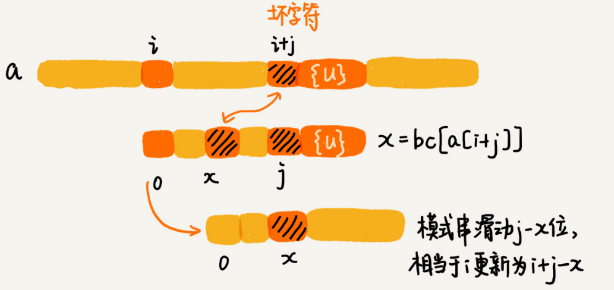

至此，我们已经实现了包含坏字符规则的框架代码，只剩下往框架代码中填充好后缀规则了。现在，我们就来看看，如何实现好后缀规则。它的实现要比坏字符规则复杂一些。

在讲实现之前，我们先简单回顾一下，前面讲过好后缀的处理规则中最核心的内容：

- 在模式串中，查找跟好后缀匹配的另一个子串；
- 在好后缀的后缀子串中，查找最长的、能跟模式串前缀子串匹配的后缀子串；

在不考虑效率的情况下，这两个操作都可以用很“暴力”的匹配查找方式解决。但是，如果想要 BM 算法的效率很高，这部分就不能太低效。如何来做呢？

因为好后缀也是模式串本身的后缀子串，所以，我们可以在模式串和主串正式匹配之前，通过预处理模式串，预先计算好模式串的每个后缀子串，对应的另一个可匹配子串的位置。这个预处理过程比较有技巧，很不好懂，应该是这节最难懂的内容了，你要认真多读几遍。

我们先来看，**如何表示模式串中不同的后缀子串呢？**因为后缀子串的最后一个字符的位置是固定的，下标为 m-1，我们只需要记录长度就可以了。通过长度，我们可以确定一个唯一的后缀子串。

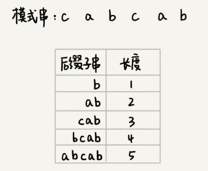

现在，我们要**引入最关键的变量 suffix 数组**。suffix 数组的下标 k，表示后缀子串的长度，下标对应的数组值存储的是，在模式串中跟好后缀{u}相匹配的子串{u*}的起始下标值。这句话不好理解，我举一个例子。

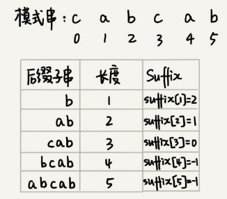

但是，如果模式串中有多个（大于 1 个）子串跟后缀子串{u}匹配，那 suffix 数组中该存储哪一个子串的起始位置呢？为了避免模式串往后滑动得过头了，我们肯定要存储模式串中最靠后的那个子串的起始位置，也就是下标最大的那个子串的起始位置。不过，这样处理就足够了吗？

实际上，仅仅是选最靠后的子串片段来存储是不够的。我们再回忆一下好后缀规则。

我们不仅要在模式串中，查找跟好后缀匹配的另一个子串，还要在好后缀的后缀子串中，查找最长的能跟模式串前缀子串匹配的后缀子串。

如果我们只记录刚刚定义的 suffix，实际上，只能处理规则的前半部分，也就是，在模式串中，查找跟好后缀匹配的另一个子串。所以，除了 suffix 数组之外，我们还需要另外一个 boolean 类型的 prefix 数组，来记录模式串的后缀子串是否能匹配模式串的前缀子串。

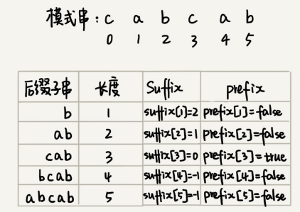

现在，我们来看下，**如何来计算并填充这两个数组的值**？这个计算过程非常巧妙。

我们拿下标从 0 到 i 的子串（i 可以是 0 到 m-2）与整个模式串，求公共后缀子串。如果公共后缀子串的长度是 k，那我们就记录 suffix[k]=j（j 表示公共后缀子串的起始下标）。如果 j 等于 0，也就是说，公共后缀子串也是模式串的前缀子串，我们就记录 prefix[k]=true。

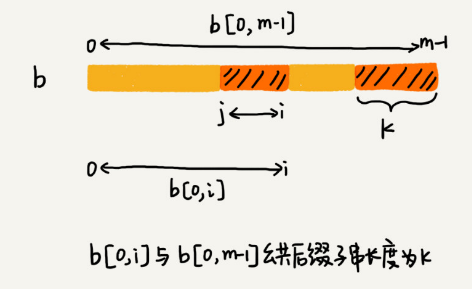

我们把 suffix 数组和 prefix 数组的计算过程，用代码实现出来，就是下面这个样子：

```java
// b 表示模式串，m 表示长度，suffix，prefix 数组事先申请好了
private void generateGS(char[] b, int m, int[] suffix, boolean[] prefix) {
  for (int i = 0; i < m; ++i) { // 初始化
    suffix[i] = -1;
    prefix[i] = false;
  }
  for (int i = 0; i < m - 1; ++i) { // b[0, i]
    int j = i;
    int k = 0; // 公共后缀子串长度
    while (j >= 0 && b[j] == b[m-1-k]) { // 与 b[0, m-1] 求公共后缀子串
      --j;
      ++k;
      suffix[k] = j+1; //j+1 表示公共后缀子串在 b[0, i] 中的起始下标
    }
    i
    if (j == -1) prefix[k] = true; // 如果公共后缀子串也是模式串的前缀子串
  }
}
```

有了这两个数组之后，我们现在来看，**在模式串跟主串匹配的过程中，遇到不能匹配的字符时，如何根据好后缀规则，计算模式串往后滑动的位数？**

假设好后缀的长度是 k。我们先拿好后缀，在 suffix 数组中查找其匹配的子串。如果 suffix[k] 不等于 -1（-1 表示不存在匹配的子串），那我们就将模式串往后移动 j-suffix[k]+1 位（j 表示坏字符对应的模式串中的字符下标）。如果 suffix[k] 等于 -1，表示模式串中不存在另一个跟好后缀匹配的子串片段。我们可以用下面这条规则来处理。

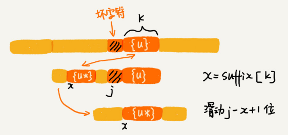

好后缀的后缀子串 b[r, m-1]（其中，r 取值从 j+2 到 m-1）的长度 k=m-r，如果 prefix[k] 等于 true，表示长度为 k 的后缀子串，有可匹配的前缀子串，这样我们可以把模式串后移 r 位。

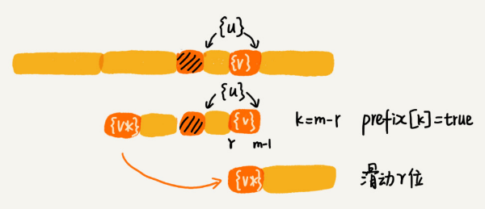

如果两条规则都没有找到可以匹配好后缀及其后缀子串的子串，我们就将整个模式串后移 m 位。


至此，好后缀规则的代码实现我们也讲完了。我们把好后缀规则加到前面的代码框架里，就可以得到 BM 算法的完整版代码实现。

```java
// a,b 表示主串和模式串；n，m 表示主串和模式串的长度。
public int bm(char[] a, int n, char[] b, int m) {
  int[] bc = new int[SIZE]; // 记录模式串中每个字符最后出现的位置
  generateBC(b, m, bc); // 构建坏字符哈希表
  int[] suffix = new int[m];
  boolean[] prefix = new boolean[m];
  generateGS(b, m, suffix, prefix);
  int i = 0; // j 表示主串与模式串匹配的第一个字符
  while (i <= n - m) {
    int j;
    for (j = m - 1; j >= 0; --j) { // 模式串从后往前匹配
      if (a[i+j] != b[j]) break; // 坏字符对应模式串中的下标是 j
    }
    if (j < 0) {
      return i; // 匹配成功，返回主串与模式串第一个匹配的字符的位置
    }
    int x = j - bc[(int)a[i+j]];
    int y = 0;
    if (j < m-1) { // 如果有好后缀的话
      y = moveByGS(j, m, suffix, prefix);
    }
    i = i + Math.max(x, y);
  }
  return -1;
}
 
// j 表示坏字符对应的模式串中的字符下标 ; m 表示模式串长度
private int moveByGS(int j, int m, int[] suffix, boolean[] prefix) {
  int k = m - 1 - j; // 好后缀长度
  if (suffix[k] != -1) return j - suffix[k] +1;
  for (int r = j+2; r <= m-1; ++r) {
    if (prefix[m-r] == true) {
      return r;
    }
  }
  return m;
}
```

## BM 算法的性能分析及优化

我们先来分析 BM 算法的内存消耗。整个算法用到了额外的 3 个数组，其中 bc 数组的大小跟字符集大小有关，suffix 数组和 prefix 数组的大小跟模式串长度 m 有关。

如果我们处理字符集很大的字符串匹配问题，bc 数组对内存的消耗就会比较多。因为好后缀和坏字符规则是独立的，如果我们运行的环境对内存要求苛刻，可以只使用好后缀规则，不使用坏字符规则，这样就可以避免 bc 数组过多的内存消耗。不过，单纯使用好后缀规则的 BM 算法效率就会下降一些了。

对于执行效率来说，我们可以先从时间复杂度的角度来分析。

实际上，我前面讲的 BM 算法是个初级版本。为了让你能更容易理解，有些复杂的优化我没有讲。基于我目前讲的这个版本，在极端情况下，预处理计算 suffix 数组、prefix 数组的性能会比较差。

比如模式串是 aaaaaaa 这种包含很多重复的字符的模式串，预处理的时间复杂度就是 O(m^2)。当然，大部分情况下，时间复杂度不会这么差。关于如何优化这种极端情况下的时间复杂度退化，如果感兴趣，你可以自己研究一下。

实际上，BM 算法的时间复杂度分析起来是非常复杂，这篇论文“[A new proof of the linearity of the Boyer-Moore string searching algorithm](http://dl.acm.org/citation.cfm?id=1382431.1382552)”证明了在最坏情况下，BM 算法的比较次数上限是 5n。这篇论文“[Tight bounds on the complexity of the Boyer-Moore string matching algorithm](http://dl.acm.org/citation.cfm?id=127830)”证明了在最坏情况下，BM 算法的比较次数上限是 3n。你可以自己阅读看看。

## 解答开篇 & 内容小结

今天，我们讲了一种比较复杂的字符串匹配算法，BM 算法。尽管复杂、难懂，但匹配的效率却很高，在实际的软件开发中，特别是一些文本编辑器中，应用比较多。如果一遍看不懂的话，你就多看几遍。

BM 算法核心思想是，利用模式串本身的特点，在模式串中某个字符与主串不能匹配的时候，将模式串往后多滑动几位，以此来减少不必要的字符比较，提高匹配的效率。BM 算法构建的规则有两类，坏字符规则和好后缀规则。好后缀规则可以独立于坏字符规则使用。因为坏字符规则的实现比较耗内存，为了节省内存，我们可以只用好后缀规则来实现 BM 算法。

## 课后思考

你熟悉的编程语言中的查找函数，或者工具、软件中的查找功能，都是用了哪种字符串匹配算法呢？


# 字符串匹配基础（下）：如何借助BM算法轻松理解KMP算法？

上一节我们讲了 BM 算法，尽管它很复杂，也不好理解，但却是工程中非常常用的一种高效字符串匹配算法。有统计说，它是最高效、最常用的字符串匹配算法。不过，在所有的字符串匹配算法里，要说最知名的一种的话，那就非 KMP 算法莫属。很多时候，提到字符串匹配，我们首先想到的就是 KMP 算法。

尽管在实际的开发中，我们几乎不大可能自己亲手实现一个 KMP 算法。但是，学习这个算法的思想，作为让你开拓眼界、锻炼下逻辑思维，也是极好的，所以我觉得有必要拿出来给你讲一讲。不过，KMP 算法是出了名的不好懂。我会尽力把它讲清楚，但是你自己也要多动动脑子。

实际上，KMP 算法跟 BM 算法的本质是一样的。上一节，我们讲了好后缀和坏字符规则，今天，我们就看下，如何借助上一节 BM 算法的讲解思路，让你能更好地理解 KMP 算法？

## KMP 算法基本原理

KMP 算法是根据三位作者（D.E.Knuth，J.H.Morris 和 V.R.Pratt）的名字来命名的，算法的全称是 Knuth Morris Pratt 算法，简称为 KMP 算法。

KMP 算法的核心思想，跟上一节讲的 BM 算法非常相近。我们假设主串是 a，模式串是 b。在模式串与主串匹配的过程中，当遇到不可匹配的字符的时候，我们希望找到一些规律，可以将模式串往后多滑动几位，跳过那些肯定不会匹配的情况。

还记得我们上一节讲到的好后缀和坏字符吗？这里我们可以类比一下，在模式串和主串匹配的过程中，把不能匹配的那个字符仍然叫作**坏字符**，把已经匹配的那段字符串叫作**好前缀**。

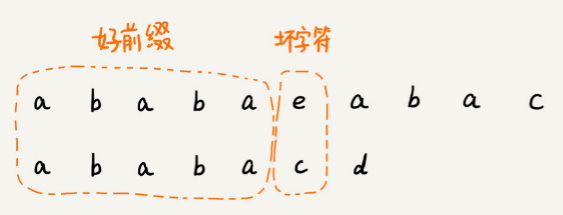

当遇到坏字符的时候，我们就要把模式串往后滑动，在滑动的过程中，只要模式串和好前缀有上下重合，前面几个字符的比较，就相当于拿好前缀的后缀子串，跟模式串的前缀子串在比较。这个比较的过程能否更高效了呢？可以不用一个字符一个字符地比较了吗？

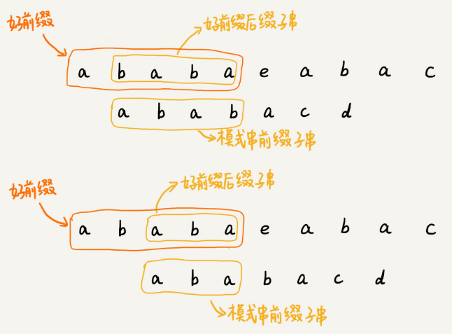

KMP 算法就是在试图寻找一种规律：在模式串和主串匹配的过程中，当遇到坏字符后，对于已经比对过的好前缀，能否找到一种规律，将模式串一次性滑动很多位？

我们只需要拿好前缀本身，在它的后缀子串中，查找最长的那个可以跟好前缀的前缀子串匹配的。假设最长的可匹配的那部分前缀子串是{v}，长度是 k。我们把模式串一次性往后滑动 j-k 位，相当于，每次遇到坏字符的时候，我们就把 j 更新为 k，i 不变，然后继续比较。

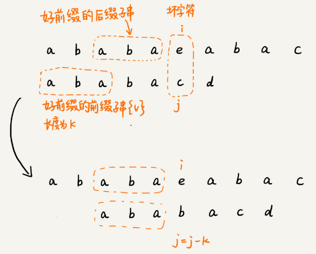

为了表述起来方便，我把好前缀的所有后缀子串中，最长的可匹配前缀子串的那个后缀子串，叫作**最长可匹配后缀子串**；对应的前缀子串，叫作**最长可匹配前缀子串**。

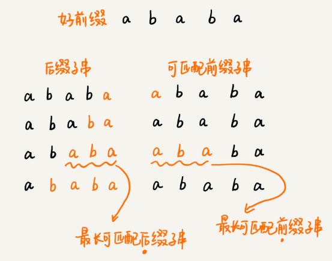

如何来求好前缀的最长可匹配前缀和后缀子串呢？我发现，这个问题其实不涉及主串，只需要通过模式串本身就能求解。所以，我就在想，能不能事先预处理计算好，在模式串和主串匹配的过程中，直接拿过来就用呢？

类似 BM 算法中的 bc、suffix、prefix 数组，KMP 算法也可以提前构建一个数组，用来存储模式串中每个前缀（这些前缀都有可能是好前缀）的最长可匹配前缀子串的结尾字符下标。我们把这个数组定义为**next 数组**，很多书中还给这个数组起了一个名字，叫**失效函数**（failure function）。

数组的下标是每个前缀结尾字符下标，数组的值是这个前缀的最长可以匹配前缀子串的结尾字符下标。这句话有点拗口，我举了一个例子，你一看应该就懂了。

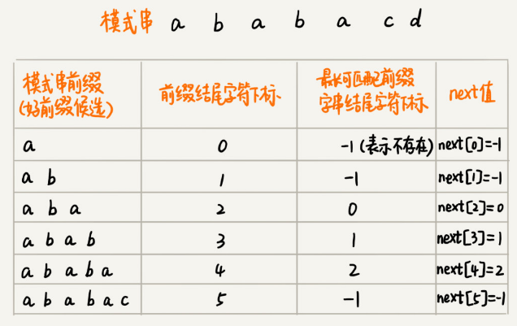

有了 next 数组，我们很容易就可以实现 KMP 算法了。我先假设 next 数组已经计算好了，先给出 KMP 算法的框架代码。

```java
// a, b 分别是主串和模式串；n, m 分别是主串和模式串的长度。
public static int kmp(char[] a, int n, char[] b, int m) {
  int[] next = getNexts(b, m);
  int j = 0;
  for (int i = 0; i < n; ++i) {
    while (j > 0 && a[i] != b[j]) { // 一直找到 a[i] 和 b[j]
      j = next[j - 1] + 1;
    }
    if (a[i] == b[j]) {
      ++j;
    }
    if (j == m) { // 找到匹配模式串的了
      return i - m + 1;
    }
  }
  return -1;
}
```

## 失效函数计算方法

KMP 算法的基本原理讲完了，我们现在来看最复杂的部分，也就是 next 数组是如何计算出来的？

当然，我们可以用非常笨的方法，比如要计算下面这个模式串 b 的 next[4]，我们就把 b[0, 4] 的所有后缀子串，从长到短找出来，依次看看，是否能跟模式串的前缀子串匹配。很显然，这个方法也可以计算得到 next 数组，但是效率非常低。有没有更加高效的方法呢？

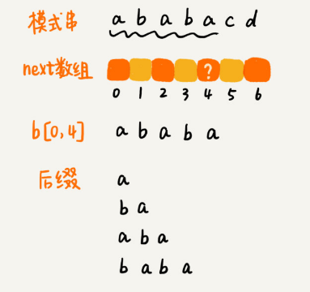

这里的处理非常有技巧，类似于动态规划。不过，动态规划我们在后面才会讲到，所以，我这里换种方法解释，也能让你听懂。

我们按照下标从小到大，依次计算 next 数组的值。当我们要计算 next[i] 的时候，前面的 next[0]，next[1]，……，next[i-1] 应该已经计算出来了。利用已经计算出来的 next 值，我们是否可以快速推导出 next[i] 的值呢？

如果 next[i-1]=k-1，也就是说，子串 b[0, k-1] 是 b[0, i-1] 的最长可匹配前缀子串。如果子串 b[0, k-1] 的下一个字符 b[k]，与 b[0, i-1] 的下一个字符 b[i] 匹配，那子串 b[0, k] 就是 b[0, i] 的最长可匹配前缀子串。所以，next[i] 等于 k。但是，如果 b[0, k-1] 的下一字符 b[k] 跟 b[0, i-1] 的下一个字符 b[i] 不相等呢？这个时候就不能简单地通过 next[i-1] 得到 next[i] 了。这个时候该怎么办呢？

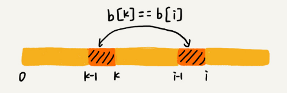

我们假设 b[0, i] 的最长可匹配后缀子串是 b[r, i]。如果我们把最后一个字符去掉，那 b[r, i-1] 肯定是 b[0, i-1] 的可匹配后缀子串，但不一定是最长可匹配后缀子串。所以，既然 b[0, i-1] 最长可匹配后缀子串对应的模式串的前缀子串的下一个字符并不等于 b[i]，那么我们就可以考察 b[0, i-1] 的次长可匹配后缀子串 b[x, i-1] 对应的可匹配前缀子串 b[0, i-1-x] 的下一个字符 b[i-x] 是否等于 b[i]。如果等于，那 b[x, i] 就是 b[0, i] 的最长可匹配后缀子串。

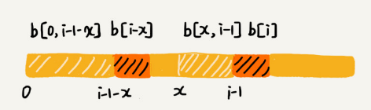

可是，如何求得 b[0, i-1] 的次长可匹配后缀子串呢？次长可匹配后缀子串肯定被包含在最长可匹配后缀子串中，而最长可匹配后缀子串又对应最长可匹配前缀子串 b[0, y]。于是，查找 b[0, i-1] 的次长可匹配后缀子串，这个问题就变成，查找 b[0, y] 的最长匹配后缀子串的问题了。

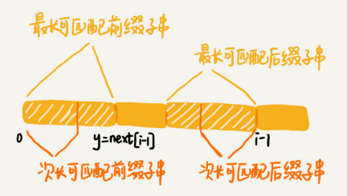

照这个思路，我们可以考察完所有的 b[0, i-1] 的可匹配后缀子串 b[y, i-1]，直到找到一个可匹配的后缀子串，它对应的前缀子串的下一个字符等于 b[i]，那这个 b[y, i] 就是 b[0, i] 的最长可匹配后缀子串。

前面我已经给出 KMP 算法的框架代码了，现在我把这部分的代码也写出来了。这两部分代码合在一起，就是整个 KMP 算法的代码实现。

```java
// b 表示模式串，m 表示模式串的长度
private static int[] getNexts(char[] b, int m) {
  int[] next = new int[m];
  next[0] = -1;
  int k = -1;
  for (int i = 1; i < m; ++i) {
    while (k != -1 && b[k + 1] != b[i]) {
      k = next[k];
    }
    if (b[k + 1] == b[i]) {
      ++k;
    }
    next[i] = k;
  }
  return next;
}
```

## KMP 算法复杂度分析

KMP 算法的原理和实现我们就讲完了，我们现在来分析一下 KMP 算法的时间、空间复杂度是多少？

空间复杂度很容易分析，KMP 算法只需要一个额外的 next 数组，数组的大小跟模式串相同。所以空间复杂度是 O(m)，m 表示模式串的长度。

KMP 算法包含两部分，第一部分是构建 next 数组，第二部分才是借助 next 数组匹配。所以，关于时间复杂度，我们要分别从这两部分来分析。

我们先来分析第一部分的时间复杂度。

计算 next 数组的代码中，第一层 for 循环中 i 从 1 到 m-1，也就是说，内部的代码被执行了 m-1 次。for 循环内部代码有一个 while 循环，如果我们能知道每次 for 循环、while 循环平均执行的次数，假设是 k，那时间复杂度就是 O(k*m)。但是，while 循环执行的次数不怎么好统计，所以我们放弃这种分析方法。

我们可以找一些参照变量，i 和 k。i 从 1 开始一直增加到 m，而 k 并不是每次 for 循环都会增加，所以，k 累积增加的值肯定小于 m。而 while 循环里 k=next[k]，实际上是在减小 k 的值，k 累积都没有增加超过 m，所以 while 循环里面 k=next[k] 总的执行次数也不可能超过 m。因此，next 数组计算的时间复杂度是 O(m)。

我们再来分析第二部分的时间复杂度。分析的方法是类似的。

i 从 0 循环增长到 n-1，j 的增长量不可能超过 i，所以肯定小于 n。而 while 循环中的那条语句 j=next[j-1]+1，不会让 j 增长的，那有没有可能让 j 不变呢？也没有可能。因为 next[j-1] 的值肯定小于 j-1，所以 while 循环中的这条语句实际上也是在让 j 的值减少。而 j 总共增长的量都不会超过 n，那减少的量也不可能超过 n，所以 while 循环中的这条语句总的执行次数也不会超过 n，所以这部分的时间复杂度是 O(n)。

所以，综合两部分的时间复杂度，KMP 算法的时间复杂度就是 O(m+n)。

## 解答开篇 & 内容小结

KMP 算法讲完了，不知道你理解了没有？如果没有，建议多看几遍，自己多思考思考。KMP 算法和上一节讲的 BM 算法的本质非常类似，都是根据规律在遇到坏字符的时候，把模式串往后多滑动几位。

BM 算法有两个规则，坏字符和好后缀。KMP 算法借鉴 BM 算法的思想，可以总结成好前缀规则。这里面最难懂的就是 next 数组的计算。如果用最笨的方法来计算，确实不难，但是效率会比较低。所以，我讲了一种类似动态规划的方法，按照下标 i 从小到大，依次计算 next[i]，并且 next[i] 的计算通过前面已经计算出来的 next[0]，next[1]，……，next[i-1] 来推导。

KMP 算法的时间复杂度是 O(n+m)，不过它的分析过程稍微需要一点技巧，不那么直观，你只要看懂就好了，并不需要掌握，在我们平常的开发中，很少会有这么难分析的代码。

## 课后思考

至此，我们把经典的单模式串匹配算法全部讲完了，它们分别是 BF 算法、RK 算法、BM 算法和 KMP 算法，关于这些算法，你觉得什么地方最难理解呢？

